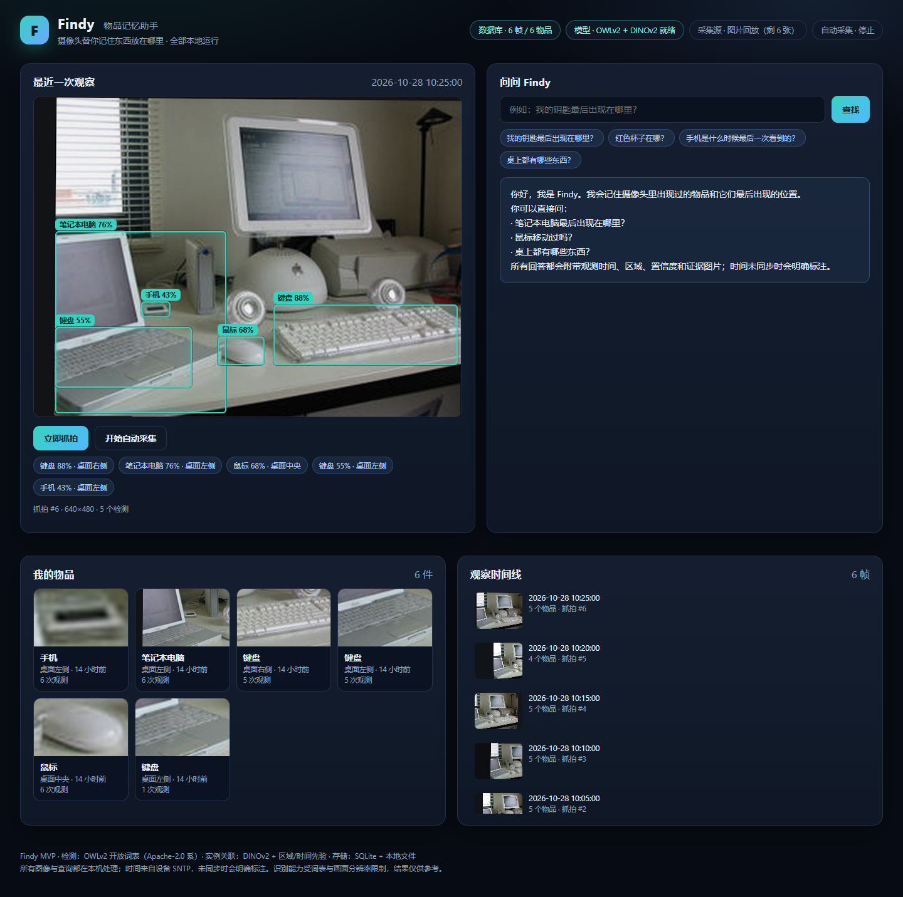

# Findy · 物品记忆助手（MVP）

Findy 用固定摄像头观察桌面环境，识别物品并记录**图像 / 时间 / 画面区域**，尽量把不同时刻出现的**同一件实物**关联起来，最后让你用一句中文问出「我的东西最后在哪」。

本仓库是 Findy 项目的**阶段二/三交付物**：在已验证的 ESP32-S3-EYE M1 采集固件之上，实现完整的本机视觉记忆闭环（检测 → 记录 → 关联 → 查询 → 展示）。全部推理与数据都留在本机。



---

## 1. 当前状态（2026-10-29）

| 阶段 | 状态 | 说明 |
|---|---|---|
| 阶段一：调研 | ✅ 完成 | 市场/需求证据、检测与 re-ID、检索/存储/查询技术路线；见 [`docs/research/`](docs/research/) |
| 阶段二：MVP 研发 | ✅ 完成（本机可运行） | 检测、实例关联、历史存储、中文查询、Web 界面、自动采集、测试 |
| 阶段三：验收 | ✅ 完成（小样本真机） | 真机 6/6 抓拍、38 次检测、自动化与浏览器验收通过；长期稳定性/精度量化未验，详见 [`docs/acceptance/ACCEPTANCE_REPORT.md`](docs/acceptance/ACCEPTANCE_REPORT.md) |
| 端到端验收工作台 | ✅ 完成（自动化 + 回放演示浏览器验收） | `/workbench`：设备探测/会话内真机切换、抓拍、检测证据、轨迹关联、找物查询、六项验收总览；replay 演示 38/38 浏览器检查通过；**真机工作台项待设备在线复验，当前 NOT VERIFIED** |

**已验证**：真实 ESP32 6/6 抓拍、38 次检测、8 条轨迹，5 类主物品 6/6 帧关联同一轨迹；演示 6 帧闭环；**89 个自动化测试通过**；Chrome/Playwright 演示 12/12、真机 7/7；**验收工作台 replay 演示 38/38**（含真实 OWLv2 检测、跨帧关联、中文查询、六项状态与脱敏导出）；异常路径有测试或实测记录。

**未验证/限制**：真实设备在线时的**工作台真机验收**尚未执行（当前设备未连接，六项中设备连接等真机项为 `NOT VERIFIED`）；真实场景量化精度（无 ground truth）、同款多件区分、长期运行稳定性未测；开放词表仍有误检/漏检；位置是「画面区域」而非三维坐标。所有细节见验收报告与 [架构决策](docs/research/C_architecture_decision.md)。

---

## 2. 它具体能做什么

1. **采集**：从 ESP32-S3-EYE M1 固件 HTTP 接口抓拍（也支持图片回放/上传），记录真实 SNTP 时间；未同步时明确标记、绝不伪造。
2. **识别**：OWLv2 开放词表检测，词表在 [`config/objects.yaml`](config/objects.yaml) 可配置（钥匙、钱包、眼镜、耳机、充电器、杯子、手机、笔记本、鼠标、键盘……），每个类别有独立阈值。
3. **记忆**：SQLite 保存每次观测的图片、时间、画面区域、检测框、置信度与外观向量；图片/裁剪图存本地文件系统。
4. **关联**：DINOv2 外观 embedding + 颜色直方图 + 区域先验 + 时间衰减打分，输出 `matched / ambiguous / new` 三态；灰区会保留候选并提示人工确认，而不是硬猜。
5. **查询**：中文规则解析（意图 + 物品别名 + 颜色/区域/时间），支持「最后位置 / 历史记录 / 是否移动 / 数量 / 区域清单 / 是否存在 / 帮助」。
6. **展示**：单页界面显示最近画面与检测框、带证据图的中文回答、物品库、观测时间线、运行状态；回答附带时间、区域、置信度、关联相似度和限制说明。

---

## 3. 快速开始（Windows，Python 3.11+）

```powershell
# 0) 进入仓库
cd D:\Findyy

# 1) 建虚拟环境并安装依赖（CPU 版 torch 即可，不需要显卡）
python -m venv .venv
.\.venv\Scripts\Activate.ps1
python -m pip install -r requirements.txt

# 2) 下载两个本地模型（OWLv2 约 620MB + DINOv2-small 约 88MB；国内会自动用 hf-mirror）
python tools\download_models.py

# 3) 生成演示抓拍序列（首次会从 COCO 官方地址下载一张公开书桌图片）
python tools\make_demo_frames.py

# 4) 回放演示序列，写入本地数据库（首次约 1 分钟，CPU 推理）
python -m findy replay --dir data/demo_frames

# 5) 启动界面
python -m findy serve
# 用户界面：http://127.0.0.1:8765
# 端到端验收工作台：http://127.0.0.1:8765/workbench
```

> 想清空重来：删除 `data/findy.sqlite*`、`data/images/`、`data/crops/` 即可（都在 `.gitignore` 内）。
> 若 `pip install` 后 `import torch` 报 DLL 初始化失败（本机 Anaconda 曾出现），请改装 CPU 版 torch（`pip install torch --index-url https://download.pytorch.org/whl/cpu`），或使用一个能正常加载 torch 的 Python 环境；验收环境说明见 [验收报告 §2](docs/acceptance/ACCEPTANCE_REPORT.md)。
> 模型也可以改成 HuggingFace 仓库 id（`config/findy.yaml` 的 `detector.model` / `embedder.model`），或设置环境变量 `FINDY_DETECTOR_MODEL` / `FINDY_EMBEDDER_MODEL`。

### 接真实设备（ESP32-S3-EYE）

1. 设备烧录并启动 Findy M1 固件（独立仓库 `D:\Findy-Firmware`），连上同一 Wi-Fi，记下串口打印的设备 IP。
2. 修改 `config/findy.yaml`：

```yaml
capture:
  source: esp32
  esp32:
    base_url: "http://<设备IP>"
```

3. 自检设备接口：`python -m findy esp32 --url http://<设备IP>`（会调用 `/api/status`）。
4. 启动服务，点「立即抓拍」；或点「开始自动采集」，按 `capture.interval_seconds` 定时抓拍。
5. **不想改配置文件时**：打开 `/workbench`，在“设备地址”填入 `http://<设备IP>`，点“检查连接” → “使用此设备采集（仅本次会话）”，再点“立即抓拍”。该切换只对当前服务进程有效，重启后恢复 `config/findy.yaml`，不会写入用户配置。

> 设备接口语义与 seq 校验见 [架构决策](docs/research/C_architecture_decision.md) 与固件仓库 README。设备离线时抓拍会返回 503 并显示明确错误，不会静默失败。

### 端到端验收工作台（`/workbench`）

打开 `http://127.0.0.1:8765/workbench`，不需要阅读终端日志或手动调用接口：

- **运行状态**：采集源（配置值/本次会话值）、设备最近探测结果、OWLv2/DINOv2 就绪状态、数据库与来源统计、最近抓拍时间、自动采集周期/失败数/最近错误原文。
- **设备采集**：“检查连接”“使用此设备采集（仅本次会话）”“恢复配置采集源”“立即抓拍”“开始采集”“停止采集”。抓拍时显示真实已等待秒数；OWLv2 CPU 单帧通常 6–11 秒，请求最长等待 240 秒，超时会提示后台可能仍在处理，不会误报成功。
- **检测结果**：最新抓拍快照（明确标注“非实时视频”）、原图与检测框、物品名/置信度/画面区域、检测与总处理耗时、失败原文、来源徽标（真实设备 / 回放演示 / 上传）。
- **轨迹关联**：轨迹列表、跨帧时间线、关联分、`matched / ambiguous / new` 状态、灰区候选与跨来源警告。
- **找物查询**：直接提问，展示中文回答、最后出现的图片、时间、画面区域、置信度与关联分。
- **验收总览**：设备连接、真实抓拍、检测、存储、轨迹关联、查询六项分别显示 `PASS` / `FAIL` / `NOT VERIFIED` 及本轮证据；“开始真实设备验收”“开始回放演示”“结束本轮验收”“导出证据 JSON”。
- **操作引导**：设备通电 → 同一 Wi-Fi → 获取 IP → 页面输入并检查连接 → 抓拍 → 移动物品后再抓拍 → 查询 → 结束验收。

验收语义（不伪造）：

- 回放运行会明确标记 `simulated=true`，横幅写明“回放演示，不计入真机验收”；replay 数据不会让真机项变成 `PASS`。
- 真实设备运行中，只有 `source_kind=esp32` 的抓拍进入真机结论；设备离线、模型未就绪、检测失败、查询无结果分别显示 `FAIL` / `NOT VERIFIED`，没有操作就是 `NOT VERIFIED`。
- 导出 JSON 不含图像，设备地址与本地绝对路径已脱敏。
- 当前运行中的 8765 若尚未重启，仍是旧代码；工作台代码已合并到仓库，重启服务后 `/workbench` 生效。升级前请确认没有正在执行的抓拍/自动采集。

---

## 4. 常用命令

| 命令 | 作用 |
|---|---|
| `python -m findy serve` | 启动 Web 服务（默认 `127.0.0.1:8765`） |
| `python -m findy status` | 打印配置、模型文件是否存在、数据库统计 |
| `python -m findy capture` | 从当前采集源抓拍一次并入库 |
| `python -m findy query "我的鼠标最后在哪？"` | 命令行执行一次自然语言查询 |
| `python -m findy replay --dir data/demo_frames` | 回放一个图片目录（验收/演示） |
| `python -m findy esp32 --url http://<IP>` | 探测设备状态 |
| `python -m pytest tests -q` | 运行 89 个自动化测试（原 75 项 + 14 项验收工作台测试） |
| `python tools\browser_acceptance.py http://127.0.0.1:8765` | 用本机 Chrome 做 12 项真实浏览器验收并截图 |
| `python tools\workbench_browser_check.py http://127.0.0.1:8766` | 对验收工作台做 38 项真实浏览器检查（需 Playwright；建议使用隔离实例） |
| `python tools\make_visual_report.py` | 生成单文件可视化报告 `docs/evidence/visual_report.html`（图片内嵌，双击离线可看） |

---

## 5. HTTP API（界面使用的同一套接口）

| 方法 | 路径 | 说明 |
|---|---|---|
| GET | `/workbench` | 端到端验收工作台页面 |
| GET | `/api/status` | 配置、模型状态、数据库统计、采集源、最近探测、自动采集状态 |
| POST | `/api/device/probe` | `{"base_url": "http://<设备IP>"}` 探测 ESP32；成功返回设备/Wi-Fi/时间/摄像头摘要，离线返回 503 |
| POST | `/api/device/connect` | 探测成功后仅在当前进程切换为 ESP32 采集源（不写配置文件） |
| POST | `/api/source/reset` | 恢复启动时配置文件中的采集源 |
| POST | `/api/capture` | 从当前采集源抓拍一次 → 检测/关联/入库；响应含来源、检测耗时与失败原文 |
| POST | `/api/observe` | 上传一张图片入库（可带 `captured_at_utc`） |
| POST | `/api/query` | `{"text": "..."}` → 中文回答 + 结果 + 证据 |
| GET | `/api/objects` | 物品库（轨迹 + 最近一次观测） |
| GET | `/api/tracks/{id}` | 单件物品详情与观测时间线 |
| POST | `/api/tracks/{id}/label` | 给物品改名 |
| POST | `/api/tracks/merge` | 人工确认「这是同一件」并合并轨迹 |
| GET | `/api/captures?limit=N` | 最近抓拍列表 |
| GET | `/api/captures/{id}/image?thumb=1` | 抓拍原图/缩略图 |
| GET | `/api/detections/{id}/crop` | 检测裁剪图 |
| POST | `/api/service/start` / `stop` | 启动/停止自动采集 |
| GET | `/api/acceptance` | 最近一轮验收运行、六项 `PASS/FAIL/NOT VERIFIED` 与系统状态 |
| POST | `/api/acceptance/run/start` | `{"mode": "real_device" \| "replay_demo"}` 开始一轮验收 |
| POST | `/api/acceptance/run/{id}/finish` | 结束本轮并保存结论（幂等） |
| GET | `/api/acceptance/run/{id}/export` | 下载脱敏验收证据 JSON（无图像数据） |
| GET | `/api/health` | 存活与数据库连通性 |

---

## 6. 目录结构

```
Findyy/
├── findy/                  # MVP Python 包（采集源、检测、embedding、关联、存储、查询、验收、API）
├── web/                    # 单页界面 + /workbench 验收工作台（HTML/CSS/JS，无构建步骤）
├── config/
│   ├── findy.yaml          # 运行配置（采集源、模型、阈值）
│   ├── objects.yaml        # 物品词表 + 中文别名 + 逐类阈值
│   └── zones.yaml          # 画面区域（归一化多边形）
├── tools/                  # 模型下载、演示数据、验收脚本
├── tests/                  # pytest（89 项）
├── docs/
│   ├── research/           # 阶段一调研 A/B + 架构决策 C
│   ├── acceptance/         # 验收报告
│   └── evidence/           # 测试/浏览器/指标证据（含 workbench/）
├── data/                   # 运行数据（gitignored：图片、数据库、模型缓存）
└── models/                 # 本地模型权重（gitignored）
```

历史遗留的 `report.md`、`assets/`、顶层的竞品/调研文档是阶段一市场调研产物，与本 MVP 代码无关。

---

## 7. 隐私、安全与许可

- **全部本地**：图像、向量、查询文本、验收事件与导出证据都不出本机；默认只监听 `127.0.0.1`。若改为局域网监听，必须自行补鉴权（当前没有）。
- **工作台隐私**：页面不使用任何 CDN/外部字体/统计脚本；验收导出 JSON 不含图像，设备地址与本地绝对路径已脱敏；真机图像与截图只留在本机 `data/`，不提交仓库。
- **不启用本机摄像头**：`capture.source` 只提供 `esp32 / replay` 实际路径；`webcam` 需要额外安装 OpenCV 且有隐私风险，MVP 不启用。演示数据来自公开 COCO 图片。
- **凭据不入库**：仓库不含任何 Wi-Fi 密码/令牌；`config/*.local.yaml`、`data/`、`models/`、`.venv/` 均已忽略。
- **模型许可**：检测用 OWLv2（HuggingFace 实现，Apache-2.0 系）、实例特征用 DINOv2（官方 model card 标注 Apache-2.0）；**刻意不依赖 Ultralytics（AGPL-3.0）**，避免闭源分发的传染风险。依赖清单与许可见验收报告。
- **位置表述**：界面只声称「画面区域」，不声称三维坐标；时间未同步时明确标注。

---

## 8. 已知限制（如实列出）

1. 演示数据是「一张公开书桌图片 + 变化模拟」，**不代表真实场景精度**；真实检测召回率、关联准确率需要现场小样本实验（方法见 [`docs/research/A_detection_reid.md`](docs/research/A_detection_reid.md) §4）。
2. 开放词表检测存在误检/漏检；小物品（钥匙、U 盘）在低分辨率下尤其明显，词表阈值需按现场重新校准。
3. 实例关联没有公开基准，当前阈值是演示数据下的初始值；同款多件可能被记为多条轨迹（界面会标「关联待确认」，可人工合并）。
4. 单帧 CPU 推理约 6–11 秒（本机 i7-14650HX），自动采集间隔需 ≥30–60 秒。
5. 未实现：变化检测触发、保留策略/清理、用户注册照、SIFT 几何校验、鉴权、多相机、三维定位。
6. 真实 ESP32 已做过小样本端到端验收（6/6 抓拍）；但**验收工作台的真机流程尚未在设备在线时复验**，当前工作台真机项为 `NOT VERIFIED`，需按工作台“操作引导”完成一次现场验收。

---

## 9. 文档

- 调研：[A 检测与实例关联](docs/research/A_detection_reid.md) · [B 检索/存储/查询](docs/research/B_retrieval_storage_query.md) · [C 架构决策](docs/research/C_architecture_decision.md)
- 验收：[验收报告](docs/acceptance/ACCEPTANCE_REPORT.md) · [证据目录](docs/evidence/) · [工作台证据](docs/evidence/workbench/)
- 项目状态：[PROJECT_STATUS](docs/PROJECT_STATUS.md)

