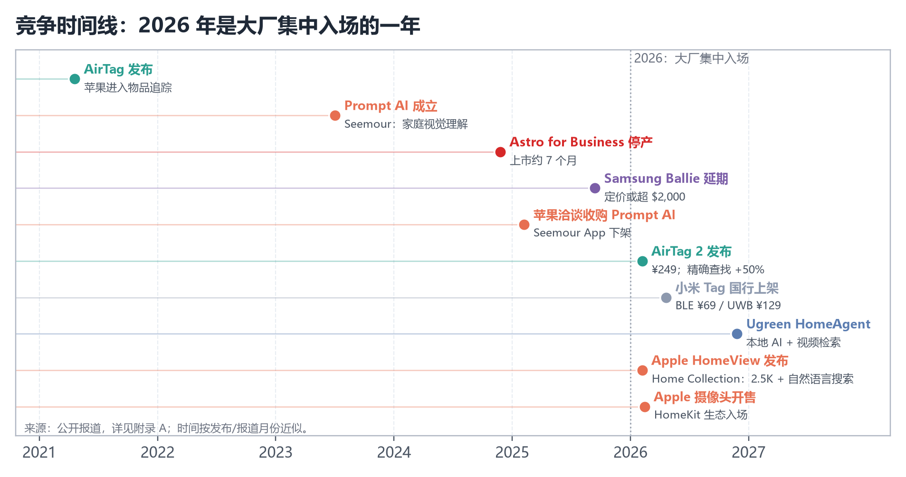
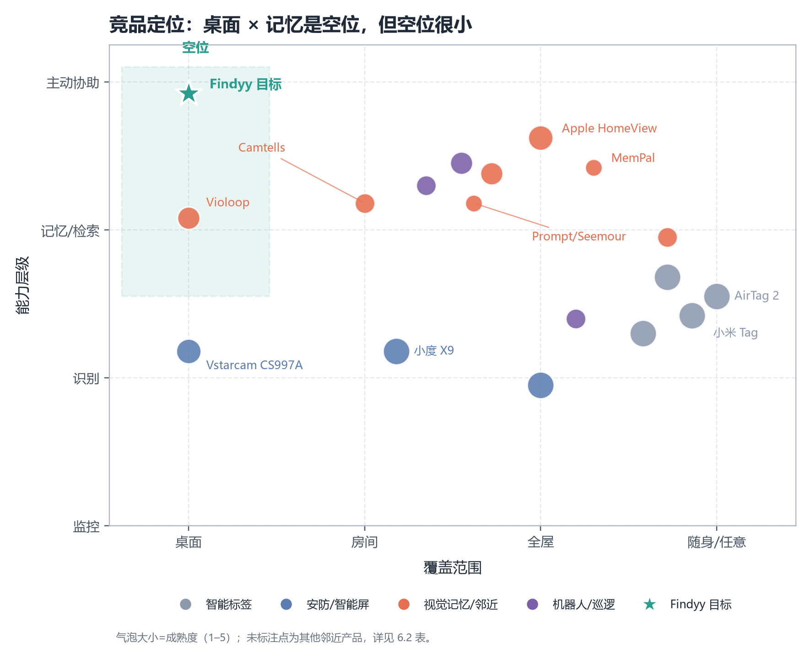
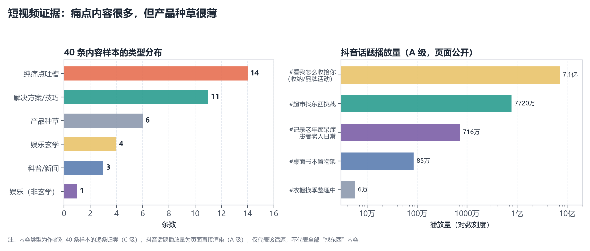
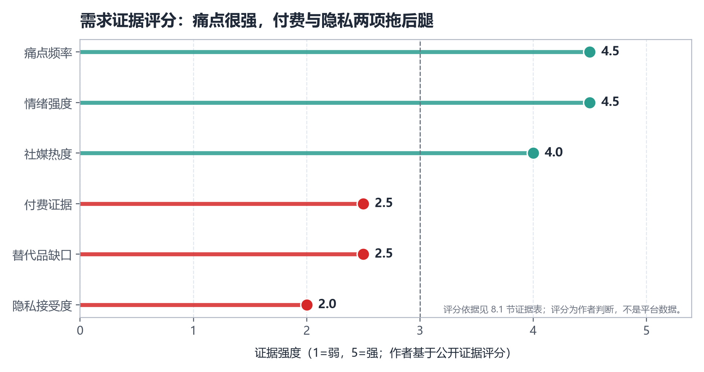
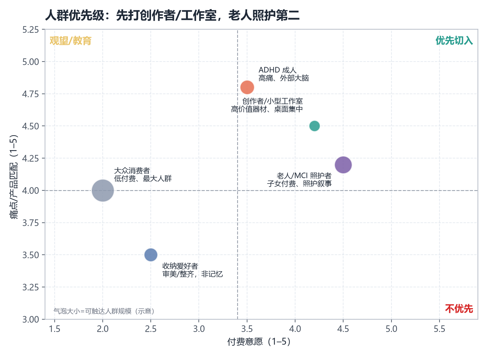
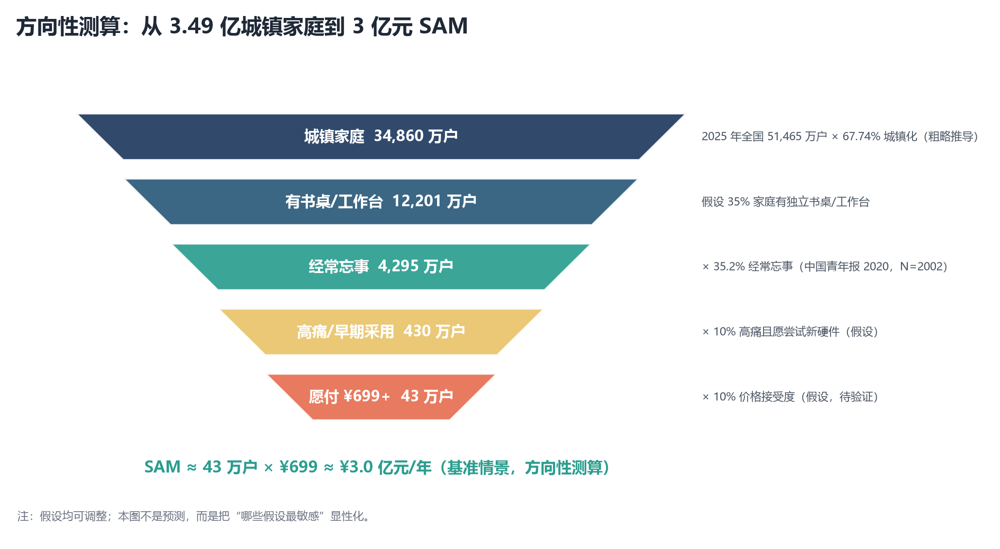
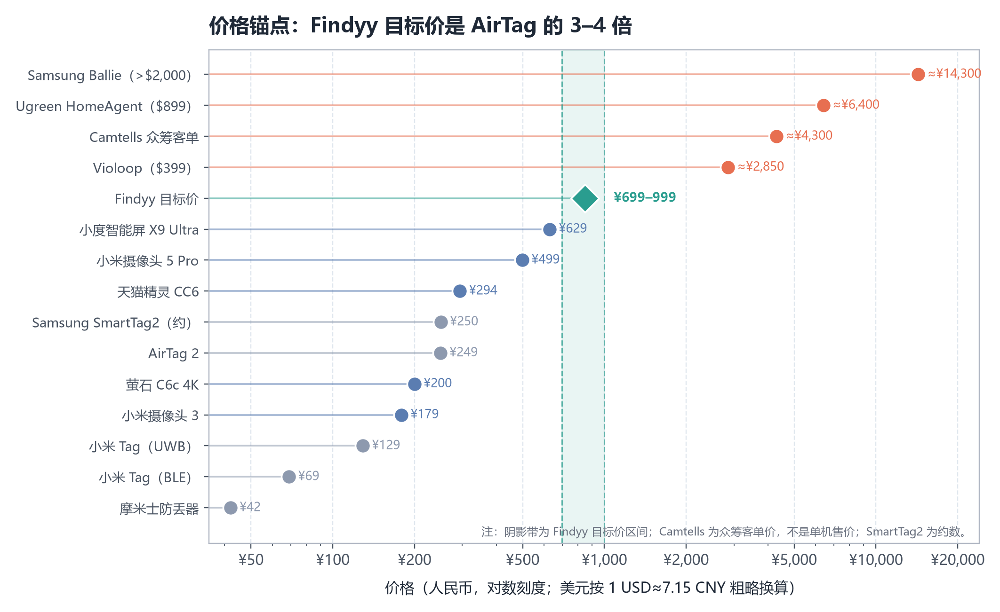
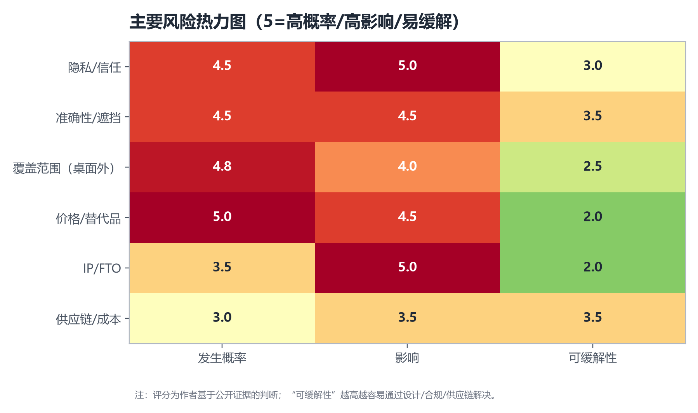
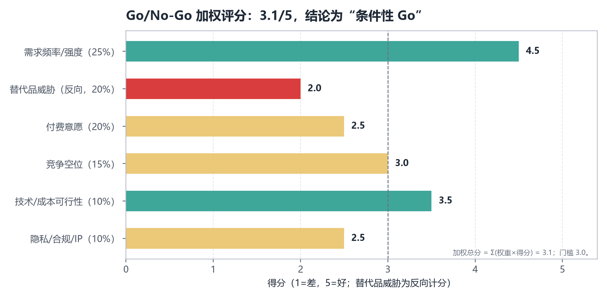

# 执行摘要

**结论：条件性 Go。** 需求是真的，但“桌面物品记忆相机”目前既没有成熟同款，也没有被验证的付费市场。建议以“创作者/小型工作室”为滩头，¥699–999 切入，先用 4 周验证定金、访谈与专利自由实施（FTO），再决定是否开模；不建议直接做大众市场的“通用找东西相机”。

## 五个关键发现

**第一，没有成熟同款，但有大量邻近玩家。** 本报告筛选了 25 个产品（矩阵按版本拆为 28 行），没有任何一款**专用硬件**同时具备“摄像头 + 物品级识别 + 长期记忆 + 自然语言检索”四要素。[S18] 最接近的 Camtells 有 360° 全景、物体库、AI 事件搜索，但 Kickstarter 只有 **24 名支持者、HK$113,167、尚未发货**；Prompt AI 的 Seemour 技术可行，却因“不向用户收费、商业模式不成立”而下架，团队被苹果收编；MemPal 是 MIT 的可穿戴研究原型（N=15）；Find My Everything 是免费 App；威视达康 CS997A 是桌面 AI 监控机器人，但没有物品记忆。[S19][S20][S21][S23] 真正量产、专注“桌面物品记忆 + 自然语言 + 截图时间戳”的成熟产品，尚未出现。

**第二，用户要的是“记忆”，不是“防丢”。** 中国青年报 2020 年对 2,002 人的调查显示，**35.2% 经常忘事、60.5% 偶尔忘事，仅 4.3% 从不忘事**；[S03] Zippo 2014 年十国调查中，中国用户平均每月花 **154 分钟**找东西，为十国最高。[S04] 抖音话题 #看我怎么收拾你 7.1 亿次播放、#超市找东西挑战 7,719.9 万次、#记录老年痴呆症患者老人的日常生活 716.1 万次；豆瓣“我丢的东西都去哪儿了”小组 5,917 人、“每天每天都在找东西”905 人。[S05][S06] 高频原话是“**明明记得之前就放在那，把家里翻了个底朝天**”“**我丢东西会一直一直一直想，想到犯强迫症**”，指向的是“我上次放哪了”的检索，而不是“物品被偷/丢了”的追踪。

**第三，付费意愿是最大不确定性。** AirTag 2 售价 **¥249**（四件 ¥849），小米 Tag **¥69/¥129**，HUAWEI Tag **¥99 起**，小度智能屏 X9 Ultra **¥629**，小米摄像头 3/5 Pro **¥179/¥499**，萤石 C6c 4K 到手约 **¥200**。[S13][S15][S16][S32][S33][S34] AirTag 已占智能 Tag 购买者的 **69%**（2024 年末），AirTag 年出货约 **3,000 万**、Samsung 约 **2,000 万**（产业研究口径）。[S11][S12] “找东西”是成熟大市场，但主流支付价是 **¥69–249**；¥699+ 的专用设备必须证明“无标签物品 + 最后出现画面 + 桌面场景”的增量价值，否则用户没有理由不买 AirTag。

**第四，大厂正在入场，窗口在收窄。** Apple 于 2026-10-13 发布 HomeView / Home Collection：2.5K 摄像头、识别人/熟悉面孔/宠物/车辆/包裹、iCloud+ 10 天视频历史、**自然语言搜索视频**、端到端加密，2026 年 12 月起开售。[S24] Ugreen HomeAgent（$899–$9,999，本地 AI + 关键词检索视频）、LG Q9、Samsung Ballie、Ring Always Home Cam、Memories.ai（$1,600 万种子，视觉记忆基础设施）[S27] 都在同一方向。[S25][S26][S28][S29][S30] 与此同时，2026 年中国消费级摄像头市场预计 **5,436 万台、同比 −1.3%**，进入存量替换；“又一台摄像头”很难起量。[S09]

**第五，风险集中在隐私、准确性、覆盖范围和 IP。** 常开摄像头进入书桌/卧室，隐私是首要阻力；桌面之外是盲区；遮挡、堆叠、小物体、反光都会让识别失败。专利侧，海康威视 CN109993045A（2018 年申请、2019 年公开）覆盖“摄像设备采集视频识别物品—保存物品信息—接收查询—匹配—判断位置变化—返回位置信息与目标图片”的流程；深圳九洲 WO2020057348A1、US10298825B2（可穿戴相机记忆/找物）等也落在同一问题空间。[S37][S38][S39] 这不等于侵权，但意味着**必须做 FTO**，不能先开模再补课。

## 建议：先打一个窄场景，不要做“通用找东西”

| 决策 | 建议 | 理由 |
|---|---|---|
| 首发人群 | **创作者/小型工作室**；第二是老人/MCI 照护者 | 高价值器材、桌面集中、可报销、愿付费；老人照护付费者是子女，需求强但隐私/准确性要求更高 |
| 产品定位 | “**桌面记忆助手**”，不是“AI 相机”或“防丢器” | 用户要的是“我上次放哪了”，不是“实时追踪”；避免与 AirTag、安防摄像头正面比价 |
| 价格 | **¥699–999**（创作者版 ¥1,299） | 高于小度 X9（¥629）但低于 Violoop（$399–699）与 Ugreen（$899+）；需用“记忆”而非硬件参数支撑 |
| 核心功能 | 一键扫描、物品库、自然语言查询、最后出现帧 + 时间 + 区域、手动纠错、本地处理、物理遮蔽、无订阅 | 差异化在“证据帧”和“记忆检索”，不在摄像头参数 |
| 渠道 | 众筹 + 内容电商 + 创作者社区；老人线走子女/养老机构 | 众筹验证需求，内容电商触达创作者，机构触达照护者 |
| 4 周验证 | 落地页 + ¥99 定金（目标 500 线索/50 定金）；30 访谈；10 户日记研究；FTO；BOM 询价 | 在开模前把“付费、可用、可绕开专利”三件事验证掉 |

**Go 的条件（缺一不可）**：

1. 定金转化率 ≥2%（50/500 线索），且退款率 <30%；
2. 30 位目标用户中 ≥30% 表示“愿意用 Findyy 替代或补充 AirTag”，并给出可接受价格 ≥¥699；
3. FTO 结论为“可设计绕开”或“可获许可”，且不触发高额赔偿风险；
4. 10k 台 BOM ≤¥350，零售 ¥699 时毛利率 ≥45%；
5. 10 户日记研究中，设备能覆盖用户 **≥60%** 的“找不到”事件（否则桌面形态的价值不成立）。

如果上述条件不满足，建议转 **App-first**（手机拍照 + 手动/半自动建档，先验证留存）或 **B2B 智能货架/工作室器材管理**（高价值、可报销、场景封闭），不要硬推消费级硬件。

---

# 1. 调研设计与证据分级

## 1.1 调研目标

本报告要回答五个问题：

1. 市场上是否已有**成熟、可购买**的直接同类？最近似产品做到什么程度？
2. 这些产品为什么没有做大：需求伪命题、替代品太强，还是成本/隐私/时机问题？
3. “找不到东西”在短视频平台是否是**高频、强情绪、可转化**的痛点？
4. 谁最愿意买、愿意付多少钱、为什么不用 AirTag 或手机拍照？
5. 结论是 **Go / 条件 Go / No-Go**；如果 Go，MVP 和下一步验证是什么？

## 1.2 方法与来源

| 证据类型 | 具体来源 | 用途 | 主要局限 |
|---|---|---|---|
| 官方统计/公报 | 国家统计局、民政部、老龄办公报 | 人口、家庭、老龄化、城镇化 | 口径差异；城镇家庭户数未单列 |
| 学术/医学 | 中国青年报调查、MCI/ADHD 研究、MIT MemPal | 痛点频率、人群规模、交互验证 | 调查年代、样本代表性 |
| 行业数据 | 洛图科技 RUNTO、IDC、Parks Associates | 摄像头/追踪器市场规模与份额 | 口径不同；部分报告付费 |
| 竞品公开页 | 官网、Kickstarter/Kicktraq、Amazon、京东、App Store | 价格、状态、功能、评价 | 页面会变；部分被反爬 |
| 短视频/社区 | 抖音话题页、豆瓣小组、小红书/B站/知乎/微博搜索摘要 | 痛点语言、内容类型、互动量级 | 视频页多为 JS 空渲染；互动数多数不可得 |
| 专利 | Google Patents、专利 PDF | IP 风险初筛 | 未做权利要求逐项比对；非法律意见 |

## 1.3 证据分级

- **A 级**：页面直接渲染或官方公报。例如抖音话题页播放量、豆瓣小组人数/回应数、国家统计局人口数据、Apple 新闻稿。
- **B 级**：搜索摘要或媒体转述。例如抖音视频的点赞徽标、小红书笔记标题、部分竞品价格。
- **C 级**：作者基于 A/B 级材料的归类、评分与推断。例如“内容类型占比”“威胁度”“TAM/SAM/SOM 假设”。

正文中凡属 C 级的判断，尽量用“作者判断/本报告估计/情景假设”标注；凡找不到可靠数据的，写“未找到/未核实”，不估算冒充数据。

## 1.4 竞品口径

- **主竞品池**只收“已量产在售/可实际购买/有真实用户评价”的产品。
- **单列“早期信号/失败案例”**：众筹未交付（Camtells）、研究原型（MemPal）、已停售（Astro、Rabbit、AI Pin）、未上市（Ballie、Ring、LG Q9）。
- 每个产品标注状态、价格、核实日期；完整矩阵按版本拆为 28 行（按产品合并为 25 个），见 `Findyy_竞品对比矩阵_2026-10.xlsx`。

## 1.5 主要限制

1. **平台访问限制**：抖音视频/图文页、小红书笔记页、B站搜索、知乎、快手在匿名访问下多返回空页/验证码/404；只有抖音话题页、豆瓣小组页、微博详情页（无互动数）可稳定读取。因此短视频部分以“40 条样本的内容编码 + 抖音话题播放量 + 豆瓣小组人数”为主，**不伪造点赞/评论数**。
2. **调查年代**：Zippo 调查为 2014 年、品牌委托；中国青年报调查为 2020 年。二者只能作方向性参考，不能代表 2026 年总体。
3. **市场测算**：TAM/SAM/SOM 为方向性，不是预测；关键假设在正文和附录中列出。
4. **未做一手调研**：本轮没有问卷/深度访谈；附录 D 给出可直接使用的访谈提纲和问卷草案。
5. **专利**：只做初筛，未做权利要求逐项比对；正式 FTO 需专利律师完成。

---

# 2. 产品与市场定义

## 2.1 产品拆解

Findyy 的形态是“桌面上的记忆摄像头”：

- **硬件**：摄像头（2K/4K）、水平 360°/垂直俯仰云台、磁吸底座、麦克风阵列、扬声器、Wi-Fi、 本地存储、物理遮蔽。
- **AI**：物体检测/分割、开放词汇识别、物品重识别、时序跟踪、多模态检索；可将“最后出现的帧”作为证据返回。
- **交互**：语音唤醒 + 自然语言提问（“耳机去哪了？”）+ 扬声器播报（方位、时间、最后画面）；App 端展示截图、时间戳、区域。
- **数据**：本地优先；物品库、事件时间线、查询历史；可选云端备份。

## 2.2 核心 Job-to-be-Done

用户真正要解决的，不是“物品被偷/丢了”，而是：

> “我明明记得把它放在这里，但就是想不起来上一次放在哪。”

这句话在短视频和豆瓣样本里反复出现。它对应三个子任务：

1. **记录**：我没刻意记，但设备帮我记；
2. **检索**：我用自然语言问，设备能答；
3. **证据**：给我看“最后一次出现在画面里”的截图、时间和位置，让我相信。

因此，Findyy 的竞品不是“另一个摄像头”，而是**人的记忆、AirTag、手机拍照、收纳习惯、问家人**。

## 2.3 与替代方案的本质区别

| 方案 | 解决什么 | 不解决什么 | 对 Findyy 的含义 |
|---|---|---|---|
| AirTag/小米 Tag | 带标签物品的“最后已知位置” | 没标签的物品；被遮挡/盖住；没有画面证据；需要换电池 | 最大替代品；Findyy 必须打“无标签 + 视觉证据” |
| 手机拍照/备忘录 | 用户主动记录 | 不会自动记录；拍完就忘；检索靠翻相册 | 免费但摩擦高；Findyy 用“自动”降摩擦 |
| 安防摄像头 | 监控/事件回放 | 不做物品级索引；不回答“耳机在哪”；隐私感强 | 硬件供应链成熟，但软件价值不同 |
| 智能屏/语音助手 | 语音问答、看护 | 无物品记忆；摄像头多为定焦/看护 | 价格锚点；也是潜在平台入口 |
| 收纳/习惯 | 从源头减少乱放 | 不能检索“已经放哪了”；依赖自律 | 内容流量大，但卖的是审美不是记忆 |
| 问家人/社区互助 | 社会关系网络 | 不可靠、不可扩展、隐私 | 免费替代；说明“记忆”是社交行为 |

## 2.4 市场边界：桌面是“特性”，也是“限制”

桌面形态有三个好处：

1. **隐私可控**：只拍桌面，不拍卧室/客厅；可以物理遮蔽；用户心理门槛低。
2. **场景高频**：书桌/工作台是耳机、眼镜、充电线、U 盘、存储卡、钥匙、药瓶、文件最常出现的地方。
3. **成本可控**：单机、固定电源、Wi-Fi、云台，比全屋/机器人便宜。

但桌面也是限制：

- **离开桌面就丢失**：用户把耳机带到客厅、把钥匙放在玄关，摄像头看不到；
- **遮挡/堆叠**：物品被书/衣服盖住，画面里没有；
- **多人/宠物**：室友/家人移动物品，设备无法区分“谁放的”；
- **新物品**：未录入的物体需要用户标注，冷启动有摩擦。

这决定了 Findyy 不能承诺“什么都能找到”，只能承诺“**在桌面视野内、最后出现过的物品**”。产品话术必须诚实，否则会被“找不到”反噬。

## 2.5 关键术语

- **物品级记忆**：以“物品”为索引，而不是以“视频片段”为索引；能回答“某物最后出现在哪”。
- **最后出现帧**：物品在画面中最后一次被识别到的截图，带时间戳和区域。
- **自然语言检索**：用户说“耳机去哪了”，系统返回物品、时间、区域、截图，而不是让用户翻时间线。
- **证据链**：截图 + 时间 + 区域 + 置信度；让用户能判断“是不是我要找的那只”。

---

# 3. 竞品全景：六类玩家，一个空位

## 3.1 六类竞品

| 类别 | 代表产品 | 成熟度 | 对 Findyy 的威胁 | 关键判断 |
|---|---|---|---|---|
| 直接同类（AI 空间/物品记忆相机） | Camtells、Prompt AI/Seemour、MemPal | 低–中 | 中 | 概念最接近，但都未规模化；Camtells 24 名支持者、Prompt 失败、MemPal 研究 |
| 智能寻物标签 | AirTag 2、小米 Tag、SmartTag2、HUAWEI Tag、Tile | 高 | **高** | 成熟、便宜、生态强；最大替代品 |
| 家庭机器人/巡逻相机 | LG Q9、Samsung Ballie、Ring、Astro、Loona、Looi | 低–中 | 低–中 | 解决“移动覆盖”，但贵、重、跳票多 |
| 安防摄像头/智能屏 | 小米、萤石、Aqara、Eufy、Tapo、小度、天猫精灵 | **高** | 中–高 | 硬件与 AI 识别成熟，价格 ¥179–629；但无物品级记忆 |
| 物品管理 App | Sortly、Itemtopia、Encircle、Find My Everything、OOrion | 中 | 中 | 手动/半自动建档；免费 App 已验证“拍照+时间+搜索” |
| 失败/停售案例 | Astro、Rabbit R1、Humane AI Pin、Google Glass、Narrative Clip [S43][S44][S45] | — | 低 | “演示惊艳、日常吃灰”是常态；警惕过度承诺 |

## 3.2 时间线：2026 年是大厂集中入场的一年

2021 年 AirTag 定义了“物品追踪”品类；2023 年 Prompt AI 尝试把“家庭摄像头”变成“可问答的视觉智能”；2024 年 Amazon Astro for Business 上市约 7 个月即停产；2025 年 Samsung Ballie 延期、苹果洽谈收购 Prompt AI；2026 年 AirTag 2、小米 Tag、Apple HomeView/Home Collection、Ugreen HomeAgent 集中出现。[S19][S28][S29][S31]

这条时间线说明两件事：

1. **“视觉记忆”不是新概念**，大厂与创业公司都在做；
2. **“物品级记忆 + 自然语言检索”仍未被产品化**，大厂目前做的是“视频搜索/事件摘要”，不是“物品索引”。

## 3.3 关键结论：没有一款同时具备四要素

本报告定义的“四要素”是：

1. 摄像头（持续采集）；
2. 物品级识别（知道画面里“是什么”）；
3. 长期记忆（保存物品出现的时间/位置/画面）；
4. 自然语言检索（用户直接问“耳机在哪”）。

25 个产品中，**没有一款专用硬件同时具备四要素**。MemPal 是研究原型，具备四要素但未产品化；Find My Everything 是免费 App，靠手动拍照，不是专用硬件；Camtells 有 1/2/3 的部分能力，但没有证据显示它支持自然语言问答；Apple HomeView 有 1/2/4 的部分能力，但索引的是“视频事件”，不是“物品”；AirTag 有 3 的部分能力，但没有摄像头/物品识别。

这既是机会，也是警告：**“四要素”没有被验证，可能是因为技术/成本/隐私还没到位，而不是因为没人想到。**

## 3.4 竞品矩阵（摘要）

| 产品 | 状态 | 价格 | 摄像头/云台 | 物品识别 | 记忆/检索 | 对 Findyy 威胁 |
|---|---|---|---|---|---|---|
| Camtells | 众筹成功、未发货 | 众筹客单 HK$4,715 | 360° 全景 | 物体库 | AI 事件搜索 | 中 |
| Prompt AI/Seemour | App 下架、被苹果收编 | 未向用户收费 | 接 Ring 等 | 人/宠物/物体 | 视频问答 | 中（技术验证） |
| MemPal | 研究原型 | 无售价 | 可穿戴 | 物体 | 语音找物 | 低 |
| Find My Everything | 免费 App | 免费 | 手机 | YOLO-World | 拍照+GPS+时间+搜索 | 中（App 替代） |
| 威视达康 CS997A | 在售 | 未核实 | 355°/90° | 万物识图 | 无 | 中（形态） |
| Apple HomeView | 2026-12 开售 | 未公布 | 2.5K | 人/宠物/车辆/包裹 | 自然语言视频搜索 | **高** |
| AirTag 2 | 在售 | ¥249 | 无 | 无 | 最后已知位置 | **高**（替代） |
| 小米 Tag | 在售 | ¥69/¥129 | 无 | 无 | 最后已知位置 | **高**（价格） |
| 小度 X9 Ultra | 在售 | ¥629 | 2MP 云台 | 看护 | 无物品记忆 | 中（价格/形态） |
| 小米摄像机 5 Pro | 在售 | ¥499 | 双摄 4K 云台 | 人形/宠物 | 无 | 中（硬件） |

注：完整矩阵按版本拆为 28 行（按产品合并为 25 个）、20+ 维度、来源与成熟度评分见 `Findyy_竞品对比矩阵_2026-10.xlsx`。

# 4. 直接同类深潜

这一章只看“最像 Findyy”的产品：它们要么做“空间理解/物品记忆”，要么做“桌面 AI 记忆”。结论先行：**没有一款成熟在售的直接同类；最接近的四类样本分别是“众筹小项目”“失败后被收编的 AI 层”“研究原型”“免费 App”。**

## 4.1 Camtells：概念最接近，但只有 24 名支持者

Camtells 是香港团队在 Kickstarter 上的项目，2026-06-02 至 07-17 众筹，46 天，主打“The First AI Camera That Understands Your Space”：360° 全景、AI 事件搜索、自动运镜、物体库、本地存储、无订阅。[S18]

| 指标 | 数据 | 解读 |
|---|---|---|
| 众筹总额 | HK$113,167 / 目标 HK$100,000（113%） | 刚过目标线，不是爆款 |
| 支持者 | **24 人** | 概念有吸引力，但购买意愿极低 |
| 客单价 | 平均 HK$4,715（≈¥4,290） | 高价小众；可能是多机/套装 |
| 交付 | 截至 2026-10 未见发货证据 | 众筹风险未消除 |
| 功能 | 360°、物体库、AI 事件搜索、无订阅 | 与 Findyy 的重合度最高 |

**它做对了什么**：把“空间理解”翻译成“事件搜索 + 物体库”，并承诺无订阅；360° 全景减少了云台/盲区问题。

**它没证明什么**：24 名支持者说明“理解空间”本身不是购买理由；用户不会为“技术很酷”付 ¥4,000+。不过，24 人也不能单独区分“需求不存在”与“营销没做好”——它足以说明该项目没有形成市场拉力，但不足以否定整个品类。它也未见自然语言问答的证据——如果没有“问一句就答”，它更接近“智能安防相机”，而不是“记忆助手”。

**对 Findyy 的启示**：不要卖“空间理解”，要卖“我上次放哪了”；不要定 ¥4,000，先验证 ¥699–999；不要只做“物体库”，要做“自然语言检索 + 证据帧”。

## 4.2 Prompt AI / Seemour：技术可行，商业模式失败

Prompt AI 2023 年成立于旧金山，2023 年拿到 500 万美元种子轮（AIX、Abstract Ventures 领投），团队约 11 人。旗舰产品 Seemour 是“家庭空间理解”的 Ambient AI：连接 Ring 等安防摄像头，识别人、宠物、物体，生成文字提醒，支持对摄像头画面提问。[S19]

| 维度 | 事实 | 解读 |
|---|---|---|
| 能力 | 人/宠物/物体识别、行为描述、视频问答 | 技术方向被验证 |
| 商业模式 | 不向用户收授权费 | 没有收入；依赖摄像头厂商/生态 |
| 结局 | App 从 App Store 下架，用户数据删除；2025-10 苹果进入收购后期谈判 | 独立产品难活，团队/技术被大厂吸收 |
| 苹果的意图 | 补 HomeKit/智能家居视觉能力；传闻中的带屏 HomePod/家庭摄像头 | 大厂把“视觉理解”当平台能力，不是独立硬件 |

**它做对了什么**：把“摄像头”变成“可问答的视觉智能”，并用多模态 LLM 处理长视频；这是 Findyy 想做的核心交互。

**它没证明什么**：**“给别人的摄像头加 AI”很难收费**。Seemour 不掌握硬件、不掌握用户关系、也不掌握数据入口；当摄像头厂商/平台自己要做时，它就被挤出。

**对 Findyy 的启示**：掌握硬件和用户关系是优势，但也是重资产；如果只做 App/AI 层，很容易被平台商品化。Findyy 的壁垒必须落在“硬件 + 数据 + 场景”三者中的至少两个。

## 4.3 MemPal：交互被学术验证，但它是可穿戴

MIT Media Lab 的 MemPal 是一个可穿戴记忆助手：相机持续记录，多模态 LLM 生成活动文字日记，用户通过语音问“某物在哪”。IUI 2025 论文报告 N=15 位老人在自己家中测试：有音频辅助时找物表现优于无辅助，任务负荷（RTLX）显著更低（p=.031），整体用户感知积极。[S20]

| 维度 | 事实 | 解读 |
|---|---|---|
| 场景 | 老人居家找物 + 记忆支持 | 与 Findyy 的目标人群高度重合 |
| 形态 | 可穿戴相机 | 覆盖范围 > 桌面，但隐私/佩戴摩擦更大 |
| 证据 | N=15，真实家庭，量化+qualitative | 交互有效，不是纯概念 |
| 局限 | 研究原型；电池/隐私/成本/准确率未产品化 | 不能直接当竞品，但能当“需求验证” |

**它做对了什么**：把“找物”定义为“记忆支持”，而不是“防丢”；用语音问答降低使用门槛；在真实家庭里做研究，而不是实验室 demo。

**它没证明什么**：可穿戴形态的日常接受度、长期留存、误报率、隐私；也没有证明用户愿意为它付多少钱。

**对 Findyy 的启示**：老人/MCI 是真实场景；“记忆支持”是比“防丢”更好的叙事；但桌面形态必须解决“离开桌面”的覆盖问题，否则不如可穿戴。

## 4.4 Find My Everything / OOrion：App 端已经被免费实现

**Find My Everything** 是一款免费 iOS App：实时 YOLO-World 识别，拍照后用 Gemini 2.5 Flash 分析，保存物体 + GPS + 时间戳，按物体名搜索“何时何地最后看到”，点物品可在原照片高亮；支持 9 种语言，v1.0.1 于 2026-03 更新；截至采集无评分/评论。[S21]

**OOrion** 是法国团队面向盲人/低视力用户的免费 App：物体/文字识别、个人物品注册、语音/文字搜索、实时引导、AI 助手。[S22]

| 产品 | 能力 | 商业模式 | 对 Findyy 的含义 |
|---|---|---|---|
| Find My Everything | 拍照建档 + GPS/时间 + 搜索 + 高亮 | 免费 | “拍照+时间+搜索”没有壁垒；硬件必须靠“自动记录”差异化 |
| OOrion | 即时找物 + 引导（无障碍） | 免费 | “找现在”与“记过去”是不同 job；无障碍是潜在合作/细分 |

**对 Findyy 的启示**：纯 App 方案会被免费产品吞掉；硬件的机会是**持续、自动、免手动的记录**，以及“物理视角 + 本地隐私”。但这也意味着 Findyy 必须把“自动”做到极致，否则用户会用手机拍照。

## 4.5 威视达康 CS997A：形态最接近的“桌面 AI 监控机器人”

CS997A 是深圳威视达康的 AI 桌面监控机器人：355° 水平 / 90° 垂直云台、200 万像素、内置电池、双向语音、AI 对话（国内豆包/通义千问，海外 Gemini）、唤醒词“你好，小鹰”、万物识图、人形检测/区域检测、TF 卡最高 256GB。[S23]

| 维度 | 事实 | 解读 |
|---|---|---|
| 形态 | 桌面云台 + 语音 + AI 识图 | 与 Findyy 的硬件形态高度接近 |
| 能力 | 识图/对话/监控 | **没有物品级记忆、没有时间戳检索、没有“最后出现帧”** |
| 定位 | 安防/看护 | 卖“安全”，不是“记忆” |
| 价格 | 未核实（同品牌产品多在 ¥200–400） | 低成本硬件已商品化 |

**它做对了什么**：把云台、语音、AI 识图做到低成本、可量产；证明“桌面 AI 相机”不是技术难题。

**它没证明什么**：用户愿意为“记忆”付溢价；它也说明，**如果 Findyy 只做“识图+对话”，就会被深圳供应链迅速复制**。

**对 Findyy 的启示**：硬件不是壁垒；壁垒是“物品索引 + 时序记忆 + 检索体验 + 隐私信任”。产品定义必须把“记忆”做成核心，而不是相机的一个滤镜。

## 4.6 Violoop：不是同一品类，但证明了“桌面 + 记忆”的付费意愿

Violoop 是深圳团队 2025-12 成立的“桌面 AI 硬件”：通过 HDMI/Type-C 读取电脑屏幕，在本地构建长期记忆，并用 Agent 操作电脑；26 TOPS；海外建议零售价 $699，Kickstarter/国内首发 $399。[S26]

| 指标 | 数据 | 解读 |
|---|---|---|
| 众筹 | 2026-09 上线 20 小时破 $100 万；截至 9/17 总额 $1,143,837、1,971 名支持者 | “桌面 + AI 记忆 + 本地隐私”叙事有强付费意愿 |
| 预订 | 全球约 1.2 万人付订金 | 需求信号强 |
| 目标用户 | 小企业主/团队创始人（约 55%）、科技极客（30%） | 与 Findyy 的创作者/工作室人群重叠 |
| 差异 | 记忆的是“屏幕内容”，不是“物理物品” | 不是直接竞品，但是定价/叙事对标 |

**它做对了什么**：把“记忆”绑定到“工作产出”（找文件、找上下文、替人做事），而不是“炫技”；用本地处理/安全芯片回应隐私；用 $399 首发降低尝试门槛。

**它没证明什么**：物理物品记忆的需求；桌面摄像头形态；硬件可靠性。

**对 Findyy 的启示**：**“记忆”可以卖到 $399–699，但必须绑定一个高价值、可衡量的工作/生活场景**。如果 Findyy 只卖“找耳机”，很难支撑这个价格；如果卖“桌面器材/资料/工具的记忆与交接”，可以。

## 4.7 Apple HomeView：最大的平台威胁

2026-10-13，Apple 发布 HomeView 与 Home Collection：与 LG、施耐德电气合作，推出室内外摄像头、恒温器、门铃、智能锁；摄像头 2.5K，识别人、熟悉面孔、宠物、车辆、包裹；视频历史存 iCloud+（10 天）；Apple Intelligence 自动生成视频描述，支持**自然语言/描述性语言搜索视频**；家庭中枢本地处理或私有云计算；端到端加密；2026 年 12 月起开售。[S24][S46]

| 维度 | Apple 的能力 | 对 Findyy 的含义 |
|---|---|---|
| 硬件 | 2.5K 摄像头、HomeKit 生态 | 硬件不弱，价格未公布但大概率有竞争力 |
| AI | 物体识别 + 视频描述 + 自然语言搜索 | 与 Findyy 的“检索”高度重叠 |
| 隐私 | 本地/私有云 + 端到端加密 | 把隐私标准抬高；Findyy 必须本地优先 |
| 渠道 | Apple Store/运营商/全球 | Findyy 无法正面竞争 |
| 缺口 | 索引“事件/视频”，不是“物品”；不是桌面专用 | Findyy 的机会在“物品级 + 桌面 + 更便宜” |

**对 Findyy 的启示**：Apple 不需要做“物品记忆”就能覆盖 70% 的“找东西”场景；Findyy 必须在一个 Apple 不做的窄场景里做到 10 倍好，否则会被“免费/自带”吞掉。

## 4.8 直接同类总结

| 产品 | 最像 Findyy 的地方 | 致命缺口 | 可借鉴 |
|---|---|---|---|
| Camtells | 360° + 物体库 + 事件搜索 | 24 名支持者、未发货、无自然语言证据 | 无订阅、物体库 |
| Prompt/Seemour | 摄像头 + 视觉问答 | 不掌握硬件、无商业模式 | 多模态视频理解 |
| MemPal | 语音找物 + 老人场景 | 可穿戴研究原型 | “记忆支持”叙事、真实家庭研究 |
| Find My Everything | 拍照 + 时间/地点 + 搜索 | 手动、无硬件、无连续记录 | 极简交互、免费 |
| Vstarcam CS997A | 桌面云台 + 语音 + 识图 | 无物品记忆 | 低成本硬件、供应链 |
| Violoop | 桌面 + 长期记忆 + 本地隐私 | 屏幕内容，不是物理物品 | 定价、众筹叙事、目标人群 |
| Apple HomeView | 物体识别 + 自然语言视频搜索 | 事件索引，不是物品索引 | 隐私标准、生态整合 |

---

# 5. 替代方案深潜：AirTag 才是真正的对手

## 5.1 AirTag 2：成熟、便宜、生态强

2026-01-26，Apple 发布 AirTag 2：第二代 UWB 芯片，查找范围最高 +50%，扬声器音量 +50%，支持 Apple Watch 精确查找；中国大陆 ¥249 单件、¥849 四件；美国 $29/$99。[S13]

| 维度 | 事实 | 对 Findyy 的含义 |
|---|---|---|
| 价格 | ¥249 / $29 | Findyy 目标价的 1/3–1/4 |
| 精确查找 | 约 30 米/100 英尺；依赖 Find My 网络 | 不是实时定位；对移动/遮挡物品不可靠 |
| 兼容性 | 改进的精确查找需要 iPhone 15 及以上（第二代 UWB）[S14] | 老 iPhone 用户体验打折 |
| 能力边界 | 只能找“带标签”的物品；没有画面证据 | Findyy 的差异点：无标签 + 视觉证据 |
| 份额 | 占智能 Tag 购买者 69%（2024 年末） | 默认答案；替代成本极低 |

用户对 AirTag 的真实抱怨，恰好是 Findyy 的机会：

- “定位更新慢”“在车里/沙发下找不到”“被东西盖住”“不知道最后一次在哪”；
- AirTag 能告诉你“大概在附近”，但不能告诉你“长什么样、什么时候、在桌面的哪个区域”。

但 Findyy 也要正视：**AirTag 已经解决了“带标签物品”的大部分场景**。Findyy 只能打“没标签、懒得贴、贴了也没用”的剩余场景，市场更小、教育成本更高。

## 5.2 小米 Tag / HUAWEI Tag / SmartTag2：价格锚点被拉到 ¥69

| 产品 | 价格 | 关键能力 | 对 Findyy 的含义 |
|---|---|---|---|
| 小米 Tag BLE | **¥69** | 10g、IP67、CR2032、1 年；兼容 Find Hub + Find My | 价格锚点极低；跨生态 |
| 小米 Tag UWB | **¥129** | UWB 精确查找，仅适配小米 17 Pro/Pro Max/Ultra | UWB 开始下沉；但生态限制 |
| HUAWEI Tag | **¥99 起**（活动 ¥51.99） | 卡片式、6g、5.6mm；华为查找网络；95% 好评 | 国产替代成熟 |
| Samsung SmartTag2 | **$29.99**（≈¥213） | BLE+UWB（限 Galaxy）、SmartThings Find；4.1/359 评价 [S17] | 安卓阵营的默认选择 |
| Tile Mate | 未核实 | BLE 众包、Life360、SOS | 西方市场老牌，但价格/生态弱于 AirTag |

**结论**：追踪器是“成熟、低价、强生态”的红海。Findyy 不能以“更准的追踪”切入，只能以“追踪不了的东西”切入。

## 5.3 安防摄像头/智能屏：硬件与 AI 都成熟，但没有“物品记忆”

2025 年中国消费级监控摄像头全渠道销量 **5,507 万台（+3.0%）**；线上占 63.6%；线上在售品牌 **>1,000 家**，年内 500+ 新入局、260+ 白牌退出；TOP4 销额份额 43.7%；小米 16.8%、萤石 11.2%、海康 8.4%。[S09] 2026 年预计 **5,436 万台（−1.3%）**，进入存量替换。[S09] 全球 2025 年消费级摄像头出货约 **1.43 亿台**。[S10]

| 产品 | 价格 | 能力 | 缺口 |
|---|---|---|---|
| 小米摄像机 3 | ¥179 | 500 万像素/3K、云台、本地 AI 检测 | 固定类别检测，无物品记忆 |
| 小米摄像机 5 Pro | ¥499 | 双摄 4K、云台、1.5T 算力、手势通话 | 无人/物检索 |
| 萤石 C6c 4K | ¥259（到手约 ¥200） | 800 万像素、云台、人形/哭声/异响 | 安防场景，无记忆 |
| Aqara Camera Hub G3 | $119.99（≈¥850）[S35] | 2K 云台、Zigbee 网关、人脸/手势 | 无自然语言/物品记忆 |
| 小度 X9 Ultra | ¥839（首销 ¥629） | 8 英寸屏、2MP 云台、AI 主动看护、自动转向 | 最接近“主动找东西”的形态，但仍无物品记忆 |
| 天猫精灵 CC6 | ¥239 | 带屏、语音、视频通话 | 老产品，无物体识别 |

**结论**：摄像头供应链、云台、AI 识别、语音都已商品化；Findyy 如果只做“又一台能识图的摄像头”，会在 ¥179–629 的价格带被碾碎。**“记忆”必须是软件价值，而不是硬件参数。**

## 5.4 物品管理 App：证明“建档”需求，但不解决“实时”

Sortly、Itemtopia、Encircle 等家庭/企业库存 App 已经证明：[S36]用户愿意为“物品清单 + 照片 + 位置 + 保修/保险”付费，尤其是搬家、保险理赔、房产管理场景。但它们的问题是：

- **手动录入**：建库成本高，难以持续；
- **静态**：不能回答“现在在哪”；
- **无视觉证据**：只有用户拍的照片，不是“最后出现帧”。

Find My Everything 把“拍照 + GPS + 时间 + 搜索”做成免费 App，进一步说明：**“建档 + 搜索”没有壁垒，“自动、持续、可检索”才是。**

## 5.5 替代方案能力矩阵

| 能力 | AirTag/标签 | 安防摄像头 | 智能屏 | 库存 App | Findyy 目标 |
|---|---|---|---|---|---|
| 无标签物品 | ✗ | 部分（需人看） | ✗ | ✓（手动） | ✓ |
| 自动记录 | ✗ | ✓（但非物品索引） | ✗ | ✗ | ✓ |
| 物品级索引 | ✗ | ✗ | ✗ | ✓（手动） | ✓ |
| 最后出现帧 | ✗ | 部分（回放） | ✗ | ✗ | ✓ |
| 自然语言检索 | ✗ | 部分（新机型） | 部分 | ✗ | ✓ |
| 桌面隐私 | ✓（无摄像头） | 低 | 低 | ✓ | 中–高（物理遮蔽） |
| 价格 | ¥69–249 | ¥179–629 | ¥239–999 | 免费–订阅 | ¥699–999 |
| 成熟度 | 高 | 高 | 高 | 中 | 低（待验证） |

## 5.6 “够用”阈值：Findyy 必须跨过的三道坎

1. **比 AirTag 多解决什么？** 无标签、被遮挡、需要画面证据的物品。
2. **比手机拍照少什么摩擦？** 不用手动拍、不用翻相册、不用整理；自动记录 + 一句话检索。
3. **比安防摄像头多什么价值？** 物品级索引 + 时间戳 + 区域 + 证据帧，而不是“事件回放”。

如果这三道坎跨不过去，用户会继续用 AirTag + 手机拍照 + 问家人；Findyy 就会变成“有趣的桌面玩具”。

---

# 6. 竞品矩阵与空位：空位存在，但很小

## 6.1 定位图：桌面 × 记忆是空位

这张图的横轴是“覆盖范围”（桌面→房间→全屋→随身），纵轴是“能力层级”（监控→识别→记忆/检索→主动协助），气泡大小是成熟度。

- **右下角**是成熟巨头：AirTag/小米 Tag（随身、识别/定位）、安防摄像头/智能屏（全屋、识别）。
- **中上部**是“视觉记忆”玩家：Apple HomeView、Ugreen、LG Q9、Ballie、Camtells、Prompt/Seemour、MemPal。
- **左上角**是 Findyy 的目标：桌面 + 记忆/检索。这个格子几乎没有人，但也没有被验证。

**关键判断**：空位存在，但“空位小”有三个原因：

1. **覆盖范围小**：桌面之外看不到，价值受限；
2. **需求被替代**：AirTag/手机拍照/问家人已经“够用”；
3. **大厂可补位**：Apple 只要在 HomeView 里加“物品索引”，就能覆盖大部分场景。

## 6.2 25 个产品的矩阵摘要（矩阵 28 行）

| 产品 | 状态 | 价格 | 核心能力 | 成熟度 | 威胁 |
|---|---|---|---|---|---|
| Camtells | 众筹未发货 | 客单 HK$4,715 | 360°+物体库+事件搜索 | 2/5 | 中 |
| Prompt/Seemour | 下架/被收编 | 未收费 | 摄像头视觉问答 | 1/5 | 中 |
| MemPal | 研究 | — | 可穿戴+语音找物 | 1/5 | 低 |
| Find My Everything | 在售 App | 免费 | 拍照+GPS+时间+搜索 | 2/5 | 中 |
| Vstarcam CS997A | 在售 | 未核实 | 桌面云台+语音+识图 | 4/5 | 中 |
| Violoop | 众筹/量产 | $399–699 | 桌面屏幕记忆+Agent | 3/5 | 中 |
| Apple HomeView | 2026-12 | 未公布 | 2.5K+物体识别+NL 视频搜索 | 4/5 | **高** |
| Ugreen HomeAgent | 预售 | $899–9,999 | 本地 AI+关键词检索 | 3/5 | 中 |
| LG Q9 | 未上市 | 未定价 | 双轮机器人+视觉+语音 | 3/5 | 低–中 |
| Samsung Ballie | 未上市 | 未公布 | 滚动机器人+投影+AI | 2/5 | 低 |
| Ring Always Home Cam | 未上市 | $249.99 | 飞行巡检 | 2/5 | 低 |
| Amazon Astro | 停售 | $1,600 | 轮式机器人+Alexa | 1/5 | 低（教训） |
| AirTag 2 | 在售 | ¥249 | UWB+Find My | 5/5 | **高** |
| 小米 Tag | 在售 | ¥69/¥129 | BLE/UWB+双生态 | 5/5 | **高** |
| HUAWEI Tag | 在售 | ¥99 起 | 华为查找 | 5/5 | 中 |
| SmartTag2 | 在售 | $29.99 | BLE/UWB+SmartThings | 5/5 | 中 |
| 小米摄像机 3/5 Pro | 在售 | ¥179/¥499 | 云台+AI 检测 | 5/5 | 中 |
| 萤石 C6c 4K | 在售 | ¥259 | 云台+安防 AI | 5/5 | 中 |
| 小度 X9 Ultra | 在售 | ¥839/629 | 带屏+云台+主动看护 | 5/5 | 中 |
| 天猫精灵 CC6 | 在售 | ¥239 | 带屏+语音 | 5/5 | 低 |
| Aqara G3 | 在售 | $119.99 | 云台+网关+人脸/手势 | 4/5 | 低 |
| Loona | 在售 | $449 | 四足机器人+GPT 语音 | 3/5 | 低 |
| Looi | 众筹/量产 | ≈₹10,000 | 手机桌面机器人 | 3/5 | 低 |
| Sortly/Itemtopia/Encircle | 在售 | 订阅 | 手动库存 | 4/5 | 低 |
| Findyy 目标 | 概念 | ¥699–999 | 桌面+物品记忆+NL+证据帧 | 1/5 | — |

注：完整矩阵按版本拆为 28 行（按产品合并为 25 个）、20+ 维度、来源与评分说明见 `Findyy_竞品对比矩阵_2026-10.xlsx`。

## 6.3 空位分析：为什么“桌面 × 记忆”没有被做出来

1. **技术难度**：开放词汇物体识别 + 物品重识别 + 时序跟踪 + 多模态检索，端侧算力/成本高；云端又涉及隐私。
2. **数据难度**：每个家庭的物品不同、摆放不同、光照不同；冷启动需要用户标注；误报会迅速摧毁信任。
3. **商业难度**：用户不愿为“可能有用”的设备付 ¥699；AirTag 只要 ¥249；大厂可以把功能免费捆绑。
4. **场景难度**：桌面之外看不到；用户不会为了“找耳机”改变摆放习惯。

Camtells 的 24 名支持者、Prompt 的下架，都是这些难度的证据。**空位不是“没人做”，而是“做了没做成”。**

## 6.4 威胁排序

| 排序 | 威胁 | 为什么 | 应对 |
|---|---|---|---|
| 1 | **Apple HomeView/Home Collection** | 生态、隐私、自然语言视频搜索、2026-12 上市 | 避开“全屋/安防”，聚焦桌面/物品级；本地优先；价格更低 |
| 2 | **AirTag 2 / 小米 Tag** | ¥69–249、成熟、默认答案 | 打“无标签 + 视觉证据”；考虑与标签互补（买不到标签的物品） |
| 3 | **小米/萤石/小度摄像头** | ¥179–629、供应链、AI 识别、渠道 | 不拼硬件参数；卖“记忆”软件价值；聚焦高价值器材 |
| 4 | **Ugreen/LG/Samsung 机器人** | 本地 AI、视频检索、品牌 | 它们贵、重、非桌面；Findyy 更轻、更便宜、更聚焦 |
| 5 | **Camtells/Prompt/MemPal** | 概念接近，但都未规模化 | 学习它们的交互，避免它们的错误（高价、无场景、无商业模式） |

## 6.5 战略含义

- **不要做“又一个 AI 相机”**：这个品类在 2026 年进入存量替换（−1.3%），且被小米/萤石/Apple 占据。
- **要做“桌面记忆助手”**：卖“我上次放哪了”，而不是“我能识图”；卖“证据帧”，而不是“摄像头参数”。
- **先做窄人群**：创作者/工作室的高价值器材，老人/MCI 的照护，而不是大众“通用找东西”。
- **把隐私做成卖点**：本地处理、物理遮蔽、无订阅；这是 Apple 的教育红利，也是小团队的信任资产。

# 7. 需求证据：痛点很强，付费很弱

## 7.1 宏观：忘事是普遍体验，找东西是高频行为

中国青年报社会调查中心 2020 年对 2,002 名受访者的调查显示：**35.2% 经常忘事，60.5% 偶尔忘事，仅 4.3% 从不忘事**；82.0% 感到身边年轻人容易忘事；64.1% 归因于情绪不稳定/心理压力，63.7% 归因于工作压力，61.5% 归因于作息不规律。[S03]

Zippo 2014 年委托的十国/地区调查显示：中国用户平均每月花 **154 分钟**找东西，为十国最高；香港 129 分钟、印度 118 分钟、日本 76 分钟；日本人一生约 75,322 分钟（约 52 天）用于找东西。[S04] 该调查为品牌委托、年代较久，只能作方向性参考，但它与“35.2% 经常忘事”的方向一致。

人群基数方面：

- 2025 年末全国 60 岁及以上人口 **32,338 万（23.0%）**，65 岁及以上 **22,365 万**；[S02]
- 中国 60+ 人群轻度认知障碍（MCI）患病率 **14.54%**（CHARLS 2018 数据，2026 年发表）；另有专家共识口径 **15.5%**；[S41]
- 中国成人 ADHD 患病率约 **2.8%–3.4%**（WHO 全球平均 2.8%；中国部分口径 3.4%；深圳样本 1.8%），按 16–59 岁人口 85,136 万估算，约 **2,400–2,900 万人**。[S42]

这些数字说明：**“找不到东西”不是小众怪癖，而是普遍体验**；尤其对老人/MCI、ADHD、独居青年，痛感更强。

## 7.2 短视频：内容很多，但产品种草很薄

本报告采集了 40 条公开内容样本（抖音 16、小红书 7、B站 3、知乎 5、微博 3、豆瓣 6），逐条编码内容类型、痛点表达、丢失物品、提到的解决方案。样本用于**内容类型与语言分析**，不用于推算总体互动量；互动量以抖音话题页、豆瓣小组页的 A 级数据为准。

### 7.2.1 内容类型：吐槽与技巧为主，产品种草仅 6/40

| 内容类型 | 条数 | 代表样本 | 解读 |
|---|---|---|---|
| 纯痛点吐槽 | 14 | 抖音“每天都能有东西丢”、豆瓣“丢一次东西要回想多久” | 共鸣强，但不直接产生购买 |
| 解决方案/技巧 | 11 | “心理学回溯定位法”“找东西大法” | 免费方法论承接需求 |
| 产品种草 | 6 | AirTag 测评、白牌防丢器、桌面收纳 | 供给存在，但声量小 |
| 娱乐玄学 | 4 | “剪刀挂门喊洋葱”“感恩老祖宗” | 零成本心理安慰，传播力强 |
| 科普/新闻 | 3 | 医生讲健忘/痴呆、演唱会遗失大疆 | 把“健忘”疾病化/事件化 |
| 娱乐（非玄学） | 1 | 综艺“年纪轻轻却很健忘” | 人设化、标签化 |

玄学（4）+ 技巧（11）= **15 条，是产品种草（6 条）的 2.5 倍**。这说明：需求目前主要被“零成本心理安慰”和“免费方法论”承接，而不是被商品承接。

### 7.2.2 平台信号：收纳是亿级母题，找东西是千万级子题

| 平台/话题 | 数据 | 说明 |
|---|---|---|
| 抖音 #看我怎么收拾你 | **7.1 亿次播放** | 索菲亚品牌发起的收纳活动，营销话题 |
| 抖音 #超市找东西挑战 | **7,719.9 万次** | “找东西”子题中较高 |
| 抖音 #记录老年痴呆症患者老人的日常生活 | **716.1 万次** | 老人找东西是百万级细分 |
| 抖音 #桌面书本置物架 | **85.1 万次** | 桌面收纳流量，但卖的是“整齐” |
| 豆瓣“我丢的东西都去哪儿了” | **5,917 人** | 最大相关小组 |
| 豆瓣“找东西”/“丢三落四”/“每天每天都在找东西” | 1,564 / 927 / 905 人 | 社群规模小，但精准 |

**关键判断**：短视频平台确实有大量“找不到东西”的内容，但它是“收纳/生活技巧”母题下的**子题**；热度真实，但不足以证明“专用硬件”的购买意愿。专用设备若挂在“找东西”下，天花板是子题量级。

### 7.2.3 用户原话：要的是“记忆”，不是“防丢”

> “明明记得之前就放在那，但就是把家里翻了个底朝天都没有。”——抖音样本

> “记不清是上周四还是周五，耳机丢了，怎么也想不起来上一次是什么时候见到他们的。”——豆瓣，2022-10-24

> “我丢东西真的会很难受，会一直一直一直想，想到犯强迫症。”——豆瓣评论

> “丢东西只会喊妈妈。”——小红书标题

> “找东西还得靠老祖宗！感恩老祖宗！”——小红书

> “P 人找东西，唯一找不到的就是东西。”——B站

这些原话指向三个产品要求：

1. **记忆**：用户要的是“我上次放哪了”，不是“物品现在在哪”；
2. **证据**：用户想看到“最后一次出现的画面”，才能相信；
3. **低摩擦**：用户不想手动记录、整理、贴标签；设备必须自动。

### 7.2.4 反证：零成本方案和社会关系是强替代

- **玄学**：“百试百灵”“感恩老祖宗”，成本为零，情绪价值高；
- **问家人**：“丢东西只会喊妈妈”，社会关系是免费替代；
- **社区互助**：微博“靠小红书算法与社区互助寻回大疆”；
- **消灭钥匙**：智能锁走“去掉钥匙”路线，绕开“记住钥匙在哪”；
- **社群规模小**：豆瓣最大相关小组 5,917 人，对比“乱乱的房间”5,224、“拖拉不是故意的”7,370，痛点真实但社群小，不是强付费人群。

### 7.2.5 平台限制

抖音视频/图文页、小红书笔记页、B站搜索、知乎、快手在匿名访问下多返回空页/验证码/404；只有抖音话题页、豆瓣小组页、微博详情页（无互动数）可稳定读取。因此本报告**不伪造点赞/评论数**，只使用可核验的 A 级数据与内容编码。补齐抖音万赞样本需要登录态或巨量算数，超出公开访问边界。

## 7.3 电商/众筹：人们在买“找东西”，但只愿付 ¥69–249

| 信号 | 数据 | 解读 |
|---|---|---|
| AirTag 份额 | 占智能 Tag 购买者 **69%**（2024 年末，2022 年初 45%） | 默认答案，生态锁定 |
| 美国家庭渗透 | 12% 互联网家庭拥有智能 Tag（2022Q3 为 7%） | 仍在增长，但远未普及 |
| AirTag 出货 | 约 **3,000 万/年**（产业研究口径） | 大市场 |
| Samsung Tag 出货 | 约 **2,000 万/年**（2025 预计） | 安卓阵营 |
| BLE Tag | 约为 AirTag 的 **2 倍** | 低价平替规模更大 |
| Camtells | **24 名支持者**、HK$113,167、未发货 | 直接同类的购买意愿很弱 |
| Violoop | $399–699、20 小时破 $100 万、1,971 名支持者 | “桌面+记忆+本地隐私”有付费意愿（但非同一品类） |

**结论**：人们愿意为“找东西”付费，但主流支付价是 **¥69–249**；¥699+ 的专用设备必须提供“标签做不到”的价值，而不是“更准的定位”。

## 7.4 需求证据评分

| 维度 | 评分 | 主要证据 | 反面/缺口 |
|---|---|---|---|
| 痛点频率 | 4.5 | 35.2% 经常忘事；154 分钟/月；抖音话题 7.1 亿 | 调查年代较久；话题是收纳母题 |
| 情绪强度 | 4.5 | “翻了个底朝天”“想到犯强迫症” | 情绪强不等于付费 |
| 社媒热度 | 4.0 | 7.1 亿/7,719.9 万/716.1 万播放；豆瓣 5,917 人 | 产品种草仅 6/40；社群小 |
| 付费证据 | 2.5 | AirTag 3,000 万/年；Camtells 24 人；Violoop $399 | 主流价 ¥69–249；直接同类众筹弱 |
| 替代品缺口 | 2.5 | AirTag 只解决带标签；免费技巧/玄学/社交互助覆盖其余 | “够用”阈值低；切换成本低 |
| 隐私接受度 | 2.0 | 常开摄像头进个人空间；Apple 端到端加密抬高门槛 | 可通过本地处理/物理遮蔽缓解，但需验证 |

**综合判断**：**痛点强、付费弱、隐私敏感**。需求不是不存在，而是被更便宜的方案承接；Findyy 的机会在“AirTag 做不到的剩余场景”，但必须用产品力证明。

## 7.5 需求结论

1. **需求真实**：忘事/找东西是普遍体验，短视频与豆瓣有稳定内容供给；
2. **需求是“记忆”不是“防丢”**：用户要“上次放哪了”，不是“实时追踪”；
3. **付费意愿未被验证**：主流支付价 ¥69–249；Camtells 24 人；没有直接同类的成功案例；
4. **替代品强、隐私是门槛**：AirTag/手机/问家人/玄学都在替代；常开摄像头必须本地优先、物理遮蔽、无订阅。

---

# 8. 人群与场景：先打创作者，老人第二

## 8.1 五类人群

| 人群 | 规模/特征 | 痛点 | 付费意愿 | 触达 | 产品匹配 |
|---|---|---|---|---|---|
| 大众消费者 | 3.49 亿城镇家庭 | 偶尔找不到 | 低（¥69–249） | 电商/内容 | 低：AirTag 够用 |
| **创作者/小型工作室** | 主播账号 2.11 亿、月活开播 3,759 万；摄影/剪辑/直播工作室 | 器材多、单价高、经常找不到存储卡/转接头/镜头盖 | **高**（可报销） | 内容社区/器材电商 | **高**：桌面集中、物品价值高 |
| **ADHD 成人** | 约 2,400–2,900 万 | 高频丢东西、执行功能困难 | 中–高 | 垂直社区/心理门诊 | 高：需要“外部大脑” |
| **老人/MCI 照护者** | 60+ 3.23 亿；MCI 14.54%–15.5% | 找药/眼镜/钥匙；家属担心 | 高（子女付费） | 养老机构/子女 | 中–高：隐私/准确性要求高 |
| 收纳爱好者 | 抖音收纳话题 7.1 亿 | 整齐/好看/腾空间 | 低–中 | 内容电商 | 低：卖审美，不卖记忆 |

数据来源：创作者/主播数据见 [S07][S08]；ADHD 见 [S42]；老人/MCI 见 [S02][S41]。

## 8.2 人群优先级

**为什么先打创作者/小型工作室？**

1. **物品价值高**：相机、镜头、存储卡、转接头、麦克风、灯光；丢一次的成本高；
2. **桌面集中**：剪辑/直播/拍摄工作台是物品高密度区域，正好匹配桌面相机；
3. **可报销**：工作室/小企业可以把设备计入成本，价格敏感度低于大众；
4. **传播性强**：创作者本身就是内容生产者，容易做口碑/测评；
5. **场景封闭**：工作室/直播间比家庭更容易控制光照、摆放、隐私。

**为什么老人/MCI 第二？**

- 需求强、付费者是子女、政策/养老机构渠道；
- 但隐私、准确性、告知同意要求更高；产品需要“照护版”（简洁、远程、无摄像头感）；
- 不建议首发就做，因为会拉长研发/合规周期。

**为什么不做大众“通用找东西”？**

- AirTag/小米 Tag 只要 ¥69–249；
- 大众不愿为“偶尔找不到”付 ¥699；
- 大众市场教育成本高，容易被“智商税”质疑。

## 8.3 场景与失败模式

| 场景 | 例子 | Findyy 能否覆盖 | 失败模式 |
|---|---|---|---|
| 桌面高频物品 | 耳机、眼镜、充电线、U 盘、存储卡 | ✓ | 被书/衣服盖住；反光；小物体 |
| 桌面高价值器材 | 镜头、麦克风、转接头、硬盘 | ✓ | 黑色器材在黑色桌面；重叠摆放 |
| 钥匙/钱包 | 玄关、包里 | ✗（桌面外） | 覆盖不到；需要多机/标签 |
| 药品/眼镜（老人） | 客厅、卧室 | 部分 | 离开桌面；隐私；误报 |
| 文件/票据 | 桌面、抽屉 | 部分 | 抽屉内不可见 |
| 多人/宠物 | 室友/孩子/猫移动物品 | 部分 | 无法区分“谁放的”；物品被拿走 |

**产品含义**：

- 首发只承诺“桌面视野内、最后出现过的物品”，不承诺“全屋”；
- 对“离开桌面”的物品，提供“最后出现位置 + 可能被带走的提示”，而不是假装能找到；
- 用“手动纠错/补录”解决遮挡和新物品；
- 未来可通过“第二台相机/手机 App/标签”扩展覆盖。

## 8.4 人群结论

**滩头**：创作者/小型工作室（高价值、桌面集中、可报销、传播强）；**第二**：老人/MCI 照护（子女付费、需求强，但隐私/准确性/合规要求高），ADHD 成人可探索（高痛、外部大脑，但触达/stigma 是挑战）；**不做**：大众“通用找东西”（AirTag 够用、价格战、教育成本高）。

---

# 9. 市场规模与付费意愿：3 亿元 SAM，但区间很宽

## 9.1 自下而上的测算

**基准情景**：

1. 城镇家庭：51,465 万户 × 67.74% ≈ **34,860 万户**（粗略推导，非官方城镇家庭户数）；[S01]
2. 有书桌/工作台：×35% ≈ **12,201 万户**（假设）；
3. 经常忘事：×35.2% ≈ **4,295 万户**（中国青年报 2020）；[S03]
4. 高痛/早期采用：×10% ≈ **430 万户**（假设）；
5. 愿付 ¥699+：×10% ≈ **43 万户**（假设）；
6. SAM ≈ 43 万户 × ¥699 ≈ **3.0 亿元/年**。

**这不是预测，而是把假设显性化**。关键敏感性如下：

| 情景 | 有书桌 | 经常忘事 | 高痛/早期 | 愿付 ¥699+ | 户数 | 单价 | SAM |
|---|---|---|---|---|---|---|---|
| 保守 | 20% | 25% | 5% | 5% | 4.4 万户 | ¥699 | **0.3 亿元** |
| 基准 | 35% | 35.2% | 10% | 10% | 43.0 万户 | ¥699 | **3.0 亿元** |
| 乐观 | 50% | 45% | 15% | 15% | 176.5 万户 | ¥999 | **17.6 亿元** |

区间从 0.3 亿到 17.6 亿，说明**假设比结论更重要**。真正需要验证的是“有书桌比例”“高痛比例”“愿付 ¥699+ 比例”，而不是争论 TAM 是 3 亿还是 17 亿。

## 9.2 交叉校验：从追踪器市场倒推

- AirTag 年出货约 **3,000 万**、Samsung 约 **2,000 万**，BLE Tag 约为 AirTag 的 **2 倍**（产业研究口径）；[S12]
- 假设中国占全球 AirTag/ Samsung Tag 的 20%–30%，则中国每年 UWB Tag 购买者约 **1,000–1,500 万**；加上 BLE Tag，整体“找东西”付费人群约 **2,000–3,000 万/年**；
- 若 Findyy 能捕获其中 **1%–3%**，按 ¥699 计算，约 **0.7–3.1 亿元/年**。

这个交叉校验与“基准 SAM 3 亿元”同一量级，说明：**Findyy 是一个“几亿元级”的细分市场，不是一个“百亿元级”的大众市场**。对创业公司足够，对 VC 的“平台故事”不够。

## 9.3 价格锚点：¥699–999 是“空档”，也是“险档”

| 价格带 | 代表产品 | 用户心理 |
|---|---|---|
| ¥42–129 | 摩米士、小米 Tag BLE/UWB | “防丢器就这个价” |

注：摩米士防丢器 ¥42 的 GPS 宣传争议见 [S40]；不构成对品牌的整体评价。
| ¥179–299 | 小米摄像头 3、萤石 C6c 4K、AirTag | “摄像头/标签很便宜” |
| ¥499–629 | 小米摄像机 5 Pro、小度 X9 Ultra | “带屏/双摄/云台才这个价” |
| **¥699–999** | **Findyy 目标** | **“你凭什么比小度还贵？”** |
| ¥2,850–6,400 | Violoop、Ugreen HomeAgent | “专业/极客/工作室” |
| ¥14,300+ | Samsung Ballie | “机器人/奢侈品” |

**Findyy 的价格风险**：

- 比小度 X9（¥629）贵，但屏幕/生态/品牌都不如小度；
- 比 AirTag（¥249）贵 3–4 倍，但只覆盖桌面；
- 比 Violoop（$399–699）便宜，但后者卖的是“工作产出”，Findyy 卖的是“找耳机”。

**定价建议**：

- 首发 **¥699**（早鸟 ¥599），创作者版 **¥999–1,299**（含支架/多机联动/工作室套餐）；
- 不强制订阅；核心功能本地；云备份/高级检索可选订阅（¥9.9–19.9/月）；
- 如果 BOM 压不到 ¥350，建议先做 ¥999 的小批量，而不是 ¥699 的亏损硬件。

## 9.4 付费意愿：最大的未验证假设

本报告没有做一手 WTP 调查，因此只能给出“价格锚点 + 行为证据”的判断：

- **支持 ¥699+ 的证据**：Camtells 客单 HK$4,715（但只有 24 人）；Violoop $399–699（20 小时破 $100 万，但它是“工作记忆”，不是“找耳机”）；Ugreen $899+（专业 hub）；Apple HomeView 价格未公布但大概率不低于 ¥1,000。
- **反对 ¥699+ 的证据**：AirTag ¥249、小米 Tag ¥69/129、小度 X9 ¥629、小米摄像头 ¥499；Camtells 只有 24 人；大众对“找东西”付费意愿低。
- **结论**：¥699–999 是“可能成立但未验证”的价格；必须用**定金测试**验证，而不是用问卷（问卷会高估）。

## 9.5 市场结论

1. **市场存在，但是“几亿元级”细分**：基准 SAM 3 亿元/年；保守 0.3 亿、乐观 17.6 亿；
2. **SOM 3 年 1,500–3,000 万元**：按 SAM 的 5%–10% 计算，约 2–4 万台/年；
3. **价格是最大风险**：¥699–999 需要强价值证明；¥499 以下更易起量但毛利难；
4. **先验证再开模**：定金、访谈、日记研究、BOM 询价，缺一不可。

# 10. 风险、合规、IP 与可行性

## 10.1 风险热力图

| 风险 | 发生概率 | 影响 | 可缓解性 | 说明 |
|---|---|---|---|---|
| 隐私/信任 | 4.5 | 5.0 | 3.0 | 常开摄像头进书桌/卧室；用户担心被拍/被上传 |
| 准确性/遮挡 | 4.5 | 4.5 | 3.5 | 小物体、反光、堆叠、光照；误报会摧毁信任 |
| 覆盖范围（桌面外） | 4.8 | 4.0 | 2.5 | 桌面之外看不到；需要多机/标签/手机 |
| 价格/替代品 | 5.0 | 4.5 | 2.0 | AirTag ¥249、小米 Tag ¥69；Findyy ¥699+ |
| IP/FTO | 3.5 | 5.0 | 2.0 | 海康/九洲/美国可穿戴专利；需设计绕开 |
| 供应链/成本 | 3.0 | 3.5 | 3.5 | 存储涨价、云台/算力成本；10k 台 BOM 难压 |

## 10.2 隐私与合规

Findyy 的产品形态决定了它必须回答“凭什么让我在你桌上放一个常开摄像头”。建议从第一天就按“隐私优先”设计：

1. **本地处理**：物体检测/识别/检索尽量在端侧完成；云端只做可选的语义增强，默认关闭。
2. **物理遮蔽**：镜头盖/物理遮挡开关，让用户“看得见”的隐私。
3. **数据最小化**：只保留物品事件帧（不是全天录像）；默认 30 天滚动删除；用户可一键清空。
4. **告知同意**：多人/合租/老人照护场景，需要明确告知与同意；提供“隐私区域”屏蔽。
5. **不做人脸识别**：首版不做身份识别，避免生物识别合规风险；多人场景只做“有人移动”的提示。
6. **合规**：中国《个人信息保护法》《数据安全法》《网络安全法》；摄像头采集需告知；跨境传输需评估；儿童/老人数据需额外保护。本报告不构成法律意见，正式上线前需法律顾问审查。
7. **第三方 SDK**：ASR/TTS/云模型供应商需签数据处理协议；避免把画面/音频默认上传。

## 10.3 准确性与失败模式

| 失败模式 | 例子 | 影响 | 缓解 |
|---|---|---|---|
| 小物体 | 存储卡、耳钉、转接头 | 识别不到/混淆 | 2K/4K + 微距模式；用户手动框选 |
| 反光/黑色 | 黑色镜头、金属桌面 | 检测框不稳 | 多角度补光；偏振/算法 |
| 遮挡/堆叠 | 书/衣服盖住 | 画面里没有 | 提示“最后出现位置”；手动补录 |
| 光照变化 | 夜间/逆光 | 识别率下降 | 红外/补光；本地模型 |
| 物品重识别 | 两只相似的耳机 | 认错 | 用户确认；多帧/位置线索 |
| 多人/宠物 | 室友拿走 | 无法区分“谁” | 只记录“移动”，不识别身份 |

**建议的验收指标**（MVP）：

- 20–30 类常见桌面物品，Top-1 识别准确率 ≥85%；
- “最后出现帧”检索成功率 ≥80%（在 10 户日记研究中）；
- 端到端响应 ≤3 秒（本地）/≤5 秒（云）；
- 误报率 ≤1 次/天（否则用户会关掉）。

## 10.4 IP/FTO：核心流程有专利覆盖

| 专利/申请 | 申请人 | 时间 | 覆盖内容 | 风险 |
|---|---|---|---|---|
| CN109993045A | 杭州海康威视系统技术有限公司 | 申请 2018-04-26；公开 2019-07-09 | 摄像设备采集视频识别物品、保存物品信息、接收查询、匹配、判断位置变化、返回位置信息与目标图片 | **高**：与 Findyy 核心流程高度重叠 |
| WO2020057348A1 | 深圳九洲电器 | 2019 年前后 | 基于高清摄像头的记忆寻物方法：图像数据包含物体信息时，获取位置并推送到移动终端 | **高**：直接“记忆寻物” |
| US10298825B2 | 美国（可穿戴相机） | 授权 | 可穿戴相机系统记忆/寻找丢失物品 | 中：可穿戴形态，但概念接近 |
| CN108009583A | 中国申请人 | 2018 前后 | 智能移动设备找东西及方法 | 中 |
| CN107451504B | 中国申请人 | 授权 | 基于光谱材料标识查找物品 | 低：技术路线不同 |

**结论**：Findyy 的核心流程不是“无人区”。必须做三件事：

1. **FTO 检索**：找专利律师对 CN109993045A、WO2020057348A1 的同族/授权状态、权利要求做逐项比对；
2. **设计绕开**：例如“物品级索引 + 多模态语义检索 + 端侧个性化”的具体实现，避免落入“保存物品信息—匹配—返回图片”的宽权利要求；
3. **自有专利**：围绕“桌面场景的物品重识别/证据帧/隐私处理”申请 2–3 件实用新型/发明，增加防御。

## 10.5 供应链与 BOM（粗略假设）

| 模块 | 低成本方案 | 高配方案 | 备注 |
|---|---|---|---|
| 摄像头 | 2K，¥40–60 | 4K，¥70–100 | 广角/低照度 |
| 云台/舵机 | 水平 355°，¥25–40 | 水平+俯仰，¥40–60 | 寿命/噪音 |
| 主控 SoC | 2 TOPS，¥50–80 | 4–6 TOPS，¥90–140 | 端侧 AI |
| 内存/存储 | 2+32GB，¥30–45 | 4+64GB，¥45–70 | 事件帧存储 |
| Wi-Fi/BT | Wi-Fi 6，¥15–25 | Wi-Fi 6 + BLE，¥20–35 | 配网 |
| 麦克风/扬声器 | 双麦+3W，¥15–25 | 四麦+5W，¥25–40 | 远场语音 |
| 结构/磁吸/外壳 | ¥40–60 | ¥60–90 | 桌面形态 |
| 电源/包装/组装 | ¥25–40 | ¥35–55 | USB-C |
| **合计** | **¥240–375** | **¥385–590** | 10k 台量级，非报价 |

按 ¥699 零售、BOM ¥300–375 计算，硬件毛利率约 **46%–57%**；扣除渠道/退货/保修/研发摊销，净利可能只有 **10%–20%**。这意味着：

- 不能靠“低价硬件 + 订阅”讲故事，首版必须硬件本身有毛利；
- 若 BOM 压不到 ¥350，建议先做 ¥999 小批量，而不是 ¥699 亏损；
- 存储芯片涨价（2026）会进一步压缩中低端硬件利润。

## 10.6 可行性结论

- **技术可行**：摄像头、云台、端侧 AI、语音、App 都有成熟供应链；难点在“物品重识别 + 时序检索 + 隐私”的软件体验。
- **工程难度中等偏高**：需要 CV/嵌入式/App/云端多角色；MVP 预计 6–9 个月。
- **最大风险不是技术，而是需求/付费/隐私/IP**：这四件事必须在开模前验证。

---

# 11. 结论与建议：条件性 Go

## 11.1 Go/No-Go 评分

| 维度 | 权重 | 得分 | 加权 | 依据 |
|---|---|---|---|---|
| 需求频率/强度 | 25% | 4.5 | 1.13 | 35.2% 经常忘事；154 分钟/月；短视频热度 |
| 替代品威胁（反向） | 20% | 2.0 | 0.40 | AirTag/小米 Tag 成熟、便宜；Apple HomeView 入场 |
| 付费意愿 | 20% | 2.5 | 0.50 | 主流价 ¥69–249；Camtells 24 人；无直接成功案例 |
| 竞争空位 | 15% | 3.0 | 0.45 | 四要素无同款，但空位小、易被补位 |
| 技术/成本可行性 | 10% | 3.5 | 0.35 | 供应链成熟；BOM 可控；软件难度高 |
| 隐私/合规/IP | 10% | 2.5 | 0.25 | 隐私门槛；核心流程有专利覆盖 |
| **合计** | **100%** | — | **3.08** | **条件性 Go（门槛 3.0）** |

评分不是“数学真理”，而是把判断显性化。3.08 刚好过线，说明：**值得做小规模验证，但不值得直接重投入开模。**

## 11.2 战略选择

### 选择一：滩头人群

- **首选**：创作者/小型工作室（摄影、剪辑、直播、播客、设计）。
- **第二**：老人/MCI 照护（子女付费、养老机构渠道）。
- **不做**：大众“通用找东西”（AirTag 够用、价格战、教育成本高）。

### 选择二：定位

- 对外：**“桌面记忆助手”** / “帮你记住东西放在哪”。
- 对内：**“物品级记忆 + 证据帧 + 自然语言检索”**。
- 避免：“AI 相机”“智能监控”“防丢器”——这些词会把 Findyy 拖进安防/AirTag 的价格战。

### 选择三：商业模式

- 硬件 **¥699–999**（早鸟 ¥599；创作者版 ¥999–1,299）。
- **不强制订阅**；核心功能本地；云备份/高级检索可选（¥9.9–19.9/月）。
- 创作者版可加“多机联动/团队共享/器材清单导出”，做 B2B 小套餐。

## 11.3 MVP 定义

| 模块 | MVP 规格 | 非目标 |
|---|---|---|
| 摄像头 | 2K/4K，水平 360°，俯仰 ±90°，广角 | 8K/变焦/夜视安防 |
| AI | 端侧物体检测 + 开放词汇识别；20–30 类桌面物品 | 人脸识别/情绪识别 |
| 记忆 | 物品事件时间线；最后出现帧 + 时间 + 区域 | 全天录像/全屋覆盖 |
| 检索 | 语音/文字自然语言查询；Top-1 结果 + 候选 | 多轮复杂推理 |
| 交互 | 唤醒词、扬声器播报、App 截图 | 全双工对话/情感陪伴 |
| 隐私 | 物理遮蔽、本地处理、30 天滚动删除 | 默认云存储 |
| 安装 | 磁吸底座 + USB-C 供电 | 电池/无线/机器人 |
| 价格 | ¥699（早鸟 ¥599） | 订阅制/免费硬件 |

**核心闭环**：一键扫描 → 物品库 → 问“耳机在哪” → 返回“最后出现帧 + 时间 + 桌面区域” → 用户确认/纠错 → 系统学习。

## 11.4 4 周验证计划

| 周 | 动作 | 产出 | 成功标准 |
|---|---|---|---|
| 第 1 周 | 落地页（3 个价格档）+ 预约；招募 30 位访谈对象；FTO 启动 | 500 条线索；访谈名单 | 线索成本 ≤¥30/条 |
| 第 2 周 | 30 场访谈（10 创作者/10 ADHD/10 照护者）；¥99 定金 | 访谈纪要；50 笔定金 | 定金转化 ≥2%；≥30% 愿付 ¥699 |
| 第 3 周 | 10 户日记研究（手机拍照模拟自动记录）；BOM 询价 | 覆盖报告；BOM 表 | 覆盖 ≥60% 的“找不到”事件；BOM ≤¥350 |
| 第 4 周 | 复盘；Go/No-Go；若 Go，定义 ID/工程排期 | 决策备忘录 | 5 项 Go 条件全部满足 |

## 11.5 Go/No-Go 条件

| 条件 | 阈值 | 不满足时的动作 |
|---|---|---|
| 定金转化 | ≥2%（50/500） | 调整定位/价格，或转 App-first |
| 目标用户 WTP | ≥30% 愿付 ¥699+ | 降价/减配，或转 B2B |
| 日记研究覆盖 | ≥60% 的“找不到”事件 | 增加第二台相机/标签/手机方案 |
| FTO | 可绕开/可许可 | 重新设计或放弃 |
| BOM | ≤¥350（10k 台） | 提价/减配/换供应链 |
| 退款率 | <30% | 产品/话术有问题，先解决 |

## 11.6 如果 No-Go：两条退路

1. **App-first**：手机拍照 + 半自动建档 + 语音检索；先用免费/低价验证留存，再考虑硬件。风险：Find My Everything 等免费产品已存在，壁垒低。
2. **B2B 智能货架/工作室器材管理**：为摄影棚、直播间、实验室、办公室做“器材/工具记忆与借用登记”；客单价高、场景封闭、可报销。风险：销售周期长、定制多。

## 11.7 最终判断

Findyy 的产品直觉是对的：**“找东西”是高频痛点，“记忆”比“防丢”更接近用户语言，“桌面”是隐私与成本可控的切口。** 但市场证据同样清楚：

- 没有成熟同款，不等于没有竞争；AirTag、手机拍照、安防摄像头、Apple HomeView 都在替代；
- 需求强，不等于付费强；Camtells 的 24 名支持者是最刺眼的提醒；
- 技术可行，不等于商业可行；Prompt AI 的失败说明“AI 层”很难独立收费；
- 空位存在，但空位很小；如果找不到“高价值、高频、标签做不到”的窄场景，就会变成“有趣的桌面玩具”。

因此，建议 **条件性 Go**：用 4 周、不超过 30 万元的成本，验证“创作者/工作室愿不愿为桌面记忆付 ¥699+”。验证通过，再开模；验证不通过，转 App-first 或 B2B。**不要用“AI 相机”的叙事去融资/开模，先用“记忆”的价值去换定金。**

---

# 附录 A 来源清单

| 编号 | 来源 | URL | 日期/用途 |
|---|---|---|---|
| S01 | 国家统计局《2025 年全国 1% 人口抽样调查主要数据公报》 | https://stats.tj.gov.cn/sy_51953/jjxx/202606/t20260612_7316947.html | 2026-06-12；人口/家庭户/城镇化 |
| S02 | 民政部《2025 年度国家老龄事业发展公报》 | https://www.mca.gov.cn/n1288/n1290/n1316/c1662004999980012271/content.html | 2026-08-04；60+ 人口 |
| S03 | 中国青年报《年纪轻轻却健忘 64.1% 受访者认为是心理压力大》 | https://s.cyol.com/articles/2020-07/30/content_1VnGG0Sl.html | 2020-07-30；N=2002 调查 |
| S04 | 澎湃新闻《日本人一生中耗费约 52 天找寻丢失的东西》 | https://www.thepaper.cn/newsDetail_forward_1267701 | 2014-09-19；Zippo 十国调查 |
| S05 | 抖音话题页（#看我怎么收拾你 等） | https://www.douyin.com/hashtag/1600535838578695 | 2026-10-22；播放量 |
| S06 | 豆瓣小组（我丢的东西都去哪儿了 等） | https://www.douban.com/group/28617/ | 2026-10-22；成员数 |
| S07 | 中国演出行业协会《中国网络表演（直播与短视频）行业发展报告（2025—2026）》 | https://www.cflac.org.cn/new_ys/wlwy/dt/202607/t20260706_1367642.html | 2026-07-06；主播/用户规模 |
| S08 | 《2025 年网络视听内容创作者白皮书》 | https://www.ceweekly.cn/area/shanghai/2025/0922/481150.html | 2025-09-22；创作者账号规模 |
| S09 | 洛图科技（RUNTO）2025 年中国消费级监控摄像头年报 | http://runtotech.com/MarketInsights/info_itemid_6255_lcid_12.html | 2026-01-28；销量/份额/预测 |
| S10 | IDC 2025 全球/中国消费级摄像头数据（虎科技转述） | https://www.hukeji.com/jiadian/202603/117009.html | 2026-03-18；全球 1.43 亿台 |
| S11 | Parks Associates：AirTag 占智能 Tag 购买者 69% | https://www.parksassociates.com/index.php/blogs/in-the-news/apple-dominates-smart-tag-market-with-airtags | 2025-03-11；份额 |
| S12 | 物联网世界《2026 年，小米的 UWB-Tag 能否实现千万级的出货量》 | https://www.iotworld.com.cn/html/News/202603/949dd7a7e4c69bfc.shtml | 2026-03-20；AirTag/Samsung 出货 |
| S13 | IT之家《苹果 AirTag 2 发布》 | https://www.ithome.com/0/916/622.htm | 2026-01-26；价格/升级 |
| S14 | MacRumors：AirTag 2 精确查找需 iPhone 15+ | https://www.macrumors.com/2026/01/26/new-airtag-longer-precision-finding/ | 2026-01-26；兼容性 |
| S15 | IT之家《小米 Tag 国行上架》 | https://www.ithome.com/0/925/181.htm | 2026-03-02；¥69/¥129 |
| S16 | 什么值得买：HUAWEI Tag 活动价 ¥51.99 | https://www.smzdm.com/p/183321676/ | 2026-10-02；价格/好评率 |
| S17 | Samsung US：Galaxy SmartTag2 | https://www.samsung.com/us/mobile-accessories/galaxy-smarttag2-black-sku-ei-t5600bbegus/ | 2026-10-22；$29.99/4.1 分 |
| S18 | Kicktraq：Camtells 众筹数据 | https://www.kicktraq.com/projects/948304531/camtells-the-first-ai-camera-that-understands-your-space/ | 2026-07-18；24 人/HK$113,167 |
| S19 | 环球网/网易《苹果拟收购 Prompt AI》 | https://www.163.com/dy/article/KBJCM4VD0514R9OJ.html | 2025-10-11；Seemour 失败 |
| S20 | MIT Media Lab：MemPal | https://www.media.mit.edu/publications/mempal/ | 2025-02-05；N=15 研究 |
| S21 | App Store：Find My Everything | https://apps.apple.com/cn/app/find-my-everything/id6759879201 | 2026-10-22；免费 App |
| S22 | OOrion 官网 | https://www.oorion.fr/en/the-app | 2026-10-22；无障碍找物 |
| S23 | 威视达康 CS997A 产品页 | https://www.vstarcam.cn/wifi-units/56276.html | 2026-10-22；桌面 AI 机器人 |
| S24 | 搜狐/DoNews《苹果全新家居配件系列发布》 | https://www.sohu.com/a/1087332571_100106801 | 2026-10-13；HomeView/Home Collection |
| S25 | MacRumors：Ugreen HomeAgent | https://www.macrumors.com/2026/09/04/ugreen-launches-homeagent-hubs-qi2-chargers/ | 2026-09-04；$899–9,999 |
| S26 | 搜狐/明亮公司《众筹 20 小时破百万美元，对话 Violoop》 | https://m.sohu.com/a/1077272112_122014422/ | 2026-09-17；$399–699 |
| S27 | Dealroom：Memories.ai 融资 | https://dealroom.co/news/135651-memories-ai-raises-8m-seed-extension-for-visual-memory-ai/ | 2026-06-23；$1,600 万 |
| S28 | 搜狐/环球网《LG Q9 亮相》 | https://www.sohu.com/a/832827410_99900743 | 2024-12-03；未上市 |
| S29 | Forbes：Samsung Ballie 六年未发货 | https://www.forbes.com/sites/jonmarkman/2026/03/30/why-samsung-still-hasnt-shipped-ballie-after-six-years/ | 2026-03-30；未上市 |
| S30 | Yahoo Tech：Ring Always Home Cam | https://tech.yahoo.com/home/articles/ring-always-home-cam-real-171437022.html | 2025-09；$249.99/未上市 |
| S31 | Robotomated：Amazon Astro | https://robotomated.com/explore/consumer/amazon-astro | 2026-08；$1,600/停售 |
| S32 | IT之家《小度智能屏 X9 Ultra 发布》 | https://digi.ithome.com/archiver/0/999/707.htm | 2026-09-08；¥839/629 |
| S33 | IT之家《小米智能摄像机 5 Pro 开售》 | https://m.ithome.com/html/1011605.htm | 2026-10-11；¥499/439 |
| S34 | ZOL《萤石 C6c 4K 特惠》 | https://jd.zol.com.cn/1263/12632366.html | 2026-10-21；¥259/200 |
| S35 | SmartHomeCompared：Aqara G3 vs Eufy E220 | https://smarthomecompared.com/cameras/aqara-camera-hub-g3-vs-eufy-indoor-cam-e220 | 2026-10；$119.99/$59.99 |
| S36 | Sortly / Itemtopia / Encircle 官网/App Store | https://www.sortly.com/ | 2026-10-22；库存 App |
| S37 | 海康威视 CN109993045A 专利 | https://patents.google.com/patent/CN109993045A/zh | 申请 2018-04-26；公开 2019-07-09 |
| S38 | 深圳九洲 WO2020057348A1 | https://patents.google.com/patent/WO2020057348A1/en | PCT；记忆寻物 |
| S39 | US10298825B2 可穿戴相机找物 | https://patents.google.com/patent/US10298825B2/en | 授权；可穿戴 |
| S40 | 信网《摩米士防丢器宣称可 GPS 定位》 | http://www.qdxin.com.cn/xin/2026/390771.html | 2026-08-14；低端 tracker 风险 |
| S41 | 中国 60+ MCI 14.54%（CHARLS 2018，PMC13574534） | https://europepmc.org/articles/PMC13574534 | 2026-08；MCI |
| S42 | 中国网·心理中国《成人 ADHD 患病率约 3.4%》 | http://psy.china.com.cn/2026-01/13/content_43333609.htm | 2026-01-13；ADHD |
| S43 | 36Kr《第一批爆火 AI 硬件正悄然退场》 | https://eu.36kr.com/en/p/3672645585138436 | 2026-02-09；Rabbit R1 失败 |
| S44 | NYT：HP 收购 Humane 部分资产 | https://www.nytimes.com/2025/02/18/technology/hp-humane-ai-pin.html | 2025-02-18；AI Pin 停售 |
| S45 | BBC：Narrative Clip 关闭 | https://www.bbc.com/news/technology-37497900 | 2016-09-28； lifelogging 失败 |
| S46 | Apple Newsroom：Apple Home Collection | https://www.apple.com/au/newsroom/2026/10/introducing-apple-home-collection-a-new-lineup-of-smart-home-accessories/ | 2026-10-14；Home Collection |

注：所有 URL 于 2026-10-22 访问；部分页面（Kickstarter、Forbes、NYT）对匿名抓取返回 403，数据来自搜索摘要/转载页，已在正文标注 B 级。

# 附录 B 竞品矩阵说明

## B.1 评分口径

- **成熟度（1–5）**：5=量产在售、有规模用户/评价；4=量产在售但小众/新；3=众筹交付/小批量；2=原型/预售未交付；1=概念/停售。
- **威胁度（H/M/L）**：H=同场景+成熟+强渠道；M=邻近+可信；L=远邻/早期。
- **状态**：在售/众筹/未上市/停售；核实日期 2026-10-22。
- **价格**：当地币种原价 + 人民币约值；汇率见阅读说明。

## B.2 25 个产品清单（矩阵按版本拆为 28 行）

| # | 产品 | 类别 | 状态 | 价格 | 成熟度 | 威胁 |
|---|---|---|---|---|---|---|
| 1 | Camtells | 直接同类 | 众筹未发货 | 客单 HK$4,715 | 2 | M |
| 2 | Prompt AI/Seemour | 直接同类 | 下架/被收编 | 未收费 | 1 | M |
| 3 | MemPal | 研究原型 | 研究 | — | 1 | L |
| 4 | Find My Everything | App | 在售 | 免费 | 2 | M |
| 5 | OOrion | App（无障碍） | 在售 | 免费 | 3 | L |
| 6 | 威视达康 CS997A | 桌面 AI 相机 | 在售 | 未核实 | 4 | M |
| 7 | Violoop | 桌面 AI 记忆 | 众筹/量产 | $399–699 | 3 | M |
| 8 | Apple HomeView | 平台 | 2026-12 | 未公布 | 4 | H |
| 9 | Ugreen HomeAgent | 本地 AI hub | 预售 | $899–9,999 | 3 | M |
| 10 | LG Q9 | 机器人 | 未上市 | 未定价 | 3 | L–M |
| 11 | Samsung Ballie | 机器人 | 未上市 | 未公布 | 2 | L |
| 12 | Ring Always Home Cam | 巡逻相机 | 未上市 | $249.99 | 2 | L |
| 13 | Amazon Astro | 机器人 | 停售 | $1,600 | 1 | L |
| 14 | AirTag 2 | 追踪器 | 在售 | ¥249 | 5 | H |
| 15 | 小米 Tag | 追踪器 | 在售 | ¥69/129 | 5 | H |
| 16 | HUAWEI Tag | 追踪器 | 在售 | ¥99 起 | 5 | M |
| 17 | Samsung SmartTag2 | 追踪器 | 在售 | $29.99 | 5 | M |
| 18 | Tile Mate | 追踪器 | 在售 | 未核实 | 5 | L |
| 19 | 小米摄像机 3/5 Pro | 安防摄像头 | 在售 | ¥179/499 | 5 | M |
| 20 | 萤石 C6c 4K | 安防摄像头 | 在售 | ¥259 | 5 | M |
| 21 | 小度 X9 Ultra | 智能屏 | 在售 | ¥839/629 | 5 | M |
| 22 | 天猫精灵 CC6 | 智能屏 | 在售 | ¥239 | 5 | L |
| 23 | Aqara G3 | 安防摄像头 | 在售 | $119.99 | 4 | L |
| 24 | Loona/Looi | 桌面机器人 | 在售/众筹 | $449/≈₹10,000 | 3 | L |
| 25 | Sortly/Itemtopia/Encircle | 库存 App | 在售 | 订阅 | 4 | L |

# 附录 C 短视频样本编码（节选）

| # | 平台 | 标题/文案 | 类型 | 痛点 | 物品 | 方案 | 证据级 |
|---|---|---|---|---|---|---|---|
| 1 | 抖音 | “每天都能有东西丢在……” | 痛点吐槽 | 显性 | 日用品 | 无 | B |
| 2 | 抖音 | “明明记得之前就放在那，把家里翻了个底朝天” | 痛点/玄学 | 显性 | 家居杂物 | 玄学 | B |
| 3 | 抖音 | “心理学技巧帮你找钥匙” | 解决方案 | 显性 | 钥匙 | 回溯法 | B |
| 4 | 抖音 | AirTag 2 长期使用测评 | 产品种草 | 显性 | 耳机/钥匙/背包 | AirTag | B |
| 5 | 抖音 | 白牌防丢器（老人/小孩/钥匙扣） | 产品种草 | 隐性 | 钥匙/卡包 | 防丢器 | B |
| 6 | 抖音 | “打工人的办公桌好物分享” | 产品种草/收纳 | 隐性 | 桌面物品 | 收纳 | B |
| 7 | 小红书 | “离谱但有用，找东西大法百试百灵” | 娱乐玄学 | 显性 | 未具体 | 玄学 | B |
| 8 | 小红书 | “丢东西只会喊妈妈？” | 解决方案 | 显性 | 未具体 | 生活技巧 | B |
| 9 | 小红书 | “找东西还得靠老祖宗” | 娱乐玄学 | 显性 | 未具体 | 玄学 | B |
| 10 | B站 | “P 人找东西，唯一找不到的就是东西” | 痛点吐槽 | 显性 | 未具体 | 无 | B |
| 11 | 知乎 | “每天不停在家找不到东西怎么办？” | 痛点吐槽 | 显性 | 家居物品 | 未公开 | B |
| 12 | 豆瓣 | “丢一次东西要回想多久” | 痛点吐槽 | 显性 | 蓝牙耳机 | 无 | A（回应 4） |
| 13 | 豆瓣 | “说说你丢过的最心疼的东西” | 痛点吐槽 | 显性 | 剪报本/游戏卡/U 盘 | 无 | A（回应 167） |
| 14 | 豆瓣 | “找到了 找耳机” | 解决方案 | 显性 | 耳机 | 社区互助 | A（回应 26） |
| 15 | 微博 | “充电宝被没收，伞也丢了” | 痛点吐槽 | 显性 | 充电宝/雨伞 | 无 | A（时间）/B（正文） |

注：完整 40 条样本、URL、编码说明见 `D:\Findyy\调研_找不到东西_公开证据采集.md`。

# 附录 D 访谈提纲与问卷草案

## D.1 深访提纲（30–45 分钟）

1. 最近一次“找不到东西”是什么时候？找的是什么？当时在哪？
2. 你当时怎么找的？花了多久？最后在哪找到的？
3. 你当时的第一反应是什么？（焦虑/烦躁/放弃/问人）
4. 你有没有用 AirTag、防丢器、手机拍照、备忘录？体验如何？
5. 你桌面上最常找不到的 3 样东西是什么？
6. 如果有一个桌面摄像头能记住“最后一次出现”，你会用吗？为什么？
7. 你最担心它拍什么/传到哪？什么情况下你会关掉它？
8. 你愿意为它付多少钱？¥399/¥699/¥999/¥1,299，哪个档你会买？为什么？
9. 你希望它怎么回答你？（语音/App/截图/时间/区域）
10. 如果它只能覆盖桌面，不能覆盖客厅/玄关，你还会买吗？
11. 你会把它推荐给谁？为什么？
12. 你觉得它和 AirTag 的区别是什么？如果说不清，你会买哪个？

## D.2 问卷草案（10 题）

1. 过去一个月，你有多少次“明明记得放在某处却找不到”？0/1–2/3–5/6–10/10+
2. 最常找不到的物品（多选）：钥匙/耳机/眼镜/充电线/存储卡/文件/药/其他
3. 你通常怎么找？（多选）回想/翻找/问家人/手机拍照/ AirTag/玄学/放弃
4. 你用过 AirTag/防丢器吗？满意/一般/不满意/没用过
5. 你对“桌面摄像头记住物品位置”的兴趣：1–5
6. 你最担心的隐私问题：被拍/被上传/被黑客/家人看到/不担心
7. 你能接受的价格：<¥299/¥299–499/¥499–699/¥699–999/¥999+
8. 你希望的主要交互：语音/App/两者都要
9. 你是否愿意支付 ¥99 定金参与首发？愿意/不愿意/看价格
10. 你的身份：创作者/工作室/上班族/ADHD/照护者/其他

# 附录 E 专利初筛

| 专利 | 申请人 | 时间 | 核心内容 | 风险 | 建议 |
|---|---|---|---|---|---|
| CN109993045A | 杭州海康威视系统技术有限公司 | 申请 2018-04-26；公开 2019-07-09 | 视频识别物品—保存—查询—匹配—位置变化—返回图片/位置 | 高 | 逐项比对权利要求；设计绕开 |
| WO2020057348A1 | 深圳九洲电器 | PCT | 基于高清摄像头的记忆寻物；图像含物体信息时获取位置并推送 | 高 | 查同族/国家阶段；规避 |
| US10298825B2 | 美国申请人 | 授权 | 可穿戴相机记忆/寻找丢失物品 | 中 | 监控可穿戴扩展 |
| CN108009583A | 中国申请人 | 2018 前后 | 智能移动设备找东西 | 中 | 查权利要求 |
| CN107451504B | 中国申请人 | 授权 | 光谱材料标识查找物品 | 低 | 技术路线不同 |

注：本表仅为初筛，不构成法律意见；正式 FTO 需专利律师完成，重点核查权利要求、同族、授权状态、地域（中国/美国/欧洲）与无效可能性。

---

**报告完。** 本报告的数据、假设与结论均可追溯；如需更新，请以 2026-10-22 之后的公开信息为准。

